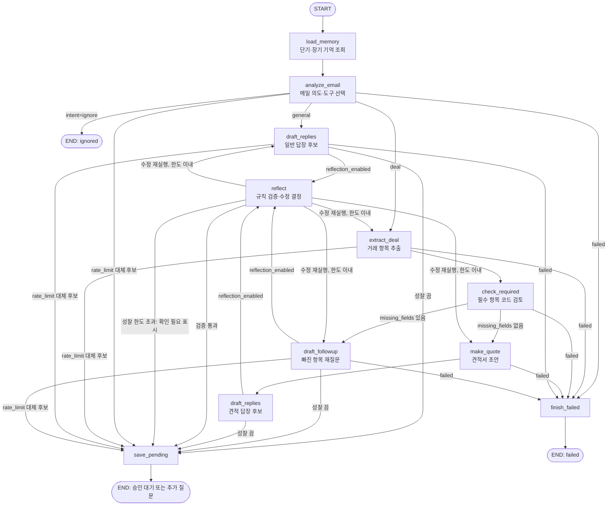
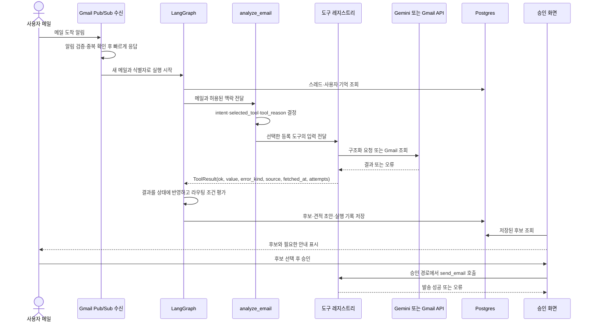

# 에이전트 아키텍처 설계서

> 초안: 최종 코드와 맞춰 20에서 고침

## 1. 범위와 기준

이 문서는 Gmail 견적 MVP의 설계 초안이다. 아직 구현 코드가 없으므로 아래의 노드, 상태, 도구 이름은 `docs/CONTRACT.md` 기준이며, 구현 때 실제 코드와 대조해 20에서 맞춘다. 요구사항: D-01, R-01~R-11 (`docs/REQUIREMENTS.md`).

서비스는 사용자가 등록한 Gmail로 도착한 메일을 처리해 답장 후보를 만든다. 메일이 거래 문의이면 거래 조건과 견적서 필수 항목을 검토하고, 빠진 항목은 재질문 후보에 담는다. 어떤 후보도 자동 발송하지 않는다. 사용자가 화면에서 승인해야 Gmail로 보낸다.

## 2. 인지·판단·행동·검증 흐름

| 단계 | 역할 | 계약상 구성요소 |
|---|---|---|
| 인지 | 메일·스레드 기억을 읽고 의도와 거래 조건을 파악한다. | `load_memory`, `analyze_email`, `extract_deal` |
| 판단 | `intent`, 필수 항목 충족 여부, 도구 결과와 오류를 보고 다음 경로를 고른다. | `routing`, `check_required`, `reflect` |
| 행동 | 후보 작성, 견적 초안 생성, 승인 대기 저장을 수행한다. | `draft_replies`, `draft_followup`, `make_quote`, `save_pending` |
| 검증 | 구조와 사실 일관성을 규칙으로 검사하고 필요하면 수정 전략을 재실행한다. | `reflect`와 `routing` |

## 3. 의도·도구 선택 정책

`analyze_email`은 현재 메일과 허용된 스레드 맥락을 바탕으로 `intent`를 `general`, `deal`, `ignore` 중 하나로 정하고 `selected_tool`과 한 문장의 `tool_reason`을 남긴다. 답변이 필요한 일반 문의는 `draft_replies`, 거래 조건이 포함된 메일은 `extract_deal_terms`로 보낸다. 자동 알림 등 응답 대상이 아니면 `ignore`로 종료한다. 분류가 불확실하거나 필수 입력이 부족하면 임의로 값을 채우지 않고 거래 경로에서 추출·필수 항목 검토를 거쳐 재질문 후보를 만든다.

`check_required_fields`는 LLM 판단이 아니라 `get_required_fields()`가 반환한 목록과 추출된 `deal_terms`를 코드로 비교한다. 현재 MVP 기본 필수 항목은 거래처명, 품목, 수량, 납기다. 모든 항목이 있으면 견적 초안을 만들고, 하나라도 비면 빠진 항목을 모두 묻는 후보를 만든다. 견적서 단가는 합의된 스레드 단가, 사용자 단가표 순서로 찾고 둘 다 없으면 `needs_price`로 두어 사용자 확인을 요청한다. 필수 항목 출처 검색이 도입되면 검색 근거를 기록하고 실패 시 기본 목록으로 대체한다.

메일 발송 도구 `send_email`은 그래프의 자동 경로에서 호출하지 않는다. 화면에서 승인된 후보만 `send_approved_candidate()` 또는 `send_approved_quote()`를 통해 발송한다. 후자는 견적서 확인을 거쳐 PDF를 첨부한다.

## 4. 노드·입출력·전이

| 노드 | 입력 | 출력·갱신 상태 | 다음 노드 조건 |
|---|---|---|---|
| `load_memory` | `user_id`, `thread_id`, 메일 | `thread_context`, `long_term` | 성공하면 `analyze_email`; 실패는 정책에 따라 빈 기억으로 계속하거나 `finish_failed` |
| `analyze_email` | `email`, 기억 | `intent`, `selected_tool`, `tool_reason`, 필요 시 `reply_mode` | 일반→`draft_replies`; 거래→`extract_deal`; 무시→종료; 한도 대체→`save_pending`; 실패→`finish_failed` |
| `extract_deal` | 메일, 스레드 맥락 | `deal_terms`, `step_status`, `errors`, `tools_called` | 성공→`check_required`; 한도 대체→`save_pending`; 실패→`finish_failed` |
| `check_required` | `deal_terms`, 필수 목록 | `required_fields`, `missing_fields`, `reply_mode` | 누락 있음→`draft_followup`; 없음→`make_quote`; 실패→`finish_failed` |
| `make_quote` | 거래 항목, 장기 기억 | `quote_draft`, `reply_mode="quote"` | 성공→`draft_replies`; 실패→`finish_failed` |
| `draft_replies` | 메일, 의도, 견적 초안(선택) | `candidates`, 호출 기록 | 성공·성찰 켬→`reflect`; 성찰 끔/한도 대체→`save_pending`; 실패→`finish_failed` |
| `draft_followup` | 메일, `missing_fields` | `candidates`, 호출 기록 | 성공·성찰 켬→`reflect`; 성찰 끔/한도 대체→`save_pending`; 실패→`finish_failed` |
| `reflect` | 후보, 거래·견적 데이터, 호출 기록 | `reflection`, `reflection_history`, 재시도 횟수, 필요 시 수정 상태 | 검증 통과 또는 한도 초과→`save_pending`; 수정 재실행→`reflection.retry_target` |
| `save_pending` | 후보, 견적 초안, 오류·안내 | 저장 결과, `end_reason` | 저장 후 종료. 후보 종류에 따라 `awaiting_approval` 또는 `followup_question` |
| `finish_failed` | 오류, 메일 식별자 | 오류 처리 상태, `end_reason="failed"` | 종료 |

각 노드는 `ToolResult`를 확인한다. 성공이면 결과를 상태에 반영하고, 한도 오류면 제한된 기본 후보와 안내를 저장하며 성찰을 생략한다. 네트워크·형식 오류는 도구/LLM 정책에 정한 재시도를 소진한 뒤 실패 종료한다. 라우팅 함수는 상태를 변경하지 않고 `step_status`, `intent`, `missing_fields`, `reflection_enabled`, `reflection`만 읽어 엣지를 선택한다.

## 5. 도구 호출 시퀀스

도구는 `app/tools/registry.py`에 등록된 이름만 호출한다. 호출 전에 `tool_select`와 선택 이유를 기록하고, 입력은 길이·키 이름 중심으로 요약해 기록한다. 결과의 `ok`와 `error_kind`를 노드가 해석해 상태와 다음 노드를 정한다. 원문 본문이나 비밀 토큰은 실행 로그에 넣지 않는다.

## 6. 상태 필드와 갱신 지점

계약의 `AgentState`는 TypedDict다. `쌓기` 필드는 LangGraph `operator.add`로 누적하고, 나머지는 각 노드 결과로 갱신한다.

| 필드 | 타입 | 초기값/출처 | 갱신 지점 |
|---|---|---|---|
| `run_id`, `user_id`, `mode` | `str`, `int`, `Literal["live","test"]` | 실행 입력 | 변경 없음 |
| `message_id`, `thread_id`, `email` | `str`, `str`, `EmailMessage` | Gmail 입력 | 변경 없음 |
| `reflection_enabled` | `bool` | 시험 옵션→사용자 설정→환경 기본값 | 변경 없음 |
| `thread_context`, `long_term` | `ThreadContext \| None`, `LongTermMemory \| None` | 빈 값 | `load_memory` |
| `intent`, `selected_tool`, `tool_reason` | `Literal["general","deal","ignore"] \| None`, `str \| None`, `str \| None` | `None` | `analyze_email`; 경로 수정 시 `reflect` |
| `tools_called` | `list[ToolCallRecord]` | `[]` | 도구 호출 노드(누적) |
| `step_status` | `Literal["ok","rate_limit","failed"]` | `"ok"` | 모든 노드 |
| `deal_terms`, `required_fields`, `missing_fields` | `DealTerms \| None`, `RequiredFields \| None`, `list[str]` | `None`, `None`, `[]` | `extract_deal`, `check_required` |
| `reply_mode`, `candidates`, `quote_draft` | `Literal["general","followup","quote"] \| None`, `list[ReplyCandidate]`, `QuoteDraft \| None` | `None`, `[]`, `None` | 분석·검토·견적·후보 노드; 필요 시 `reflect` |
| `reflection`, `reflection_history` | `ReflectionResult \| None`, `list[ReflectionResult]` | `None`, `[]` | `reflect`; 이력은 누적 |
| `call_retries` | `int` | `0` | LLM/Gmail 호출 노드(누적) |
| `reflection_retries`, `reflection_retries_by_type` | `int`, `dict[str,int]` | `0`, `{}` | `reflect` |
| `errors` | `list[AgentError]` | `[]` | 모든 노드(누적) |
| `needs_review`, `notice` | `bool`, `Literal["rate_limit","reflection_limit"] \| None` | `False`, `None` | 한도 대체 경로·`reflect` |
| `end_reason` | `Literal["awaiting_approval","followup_question","ignored","failed"] \| None` | `None` | 분석·저장·실패 종료 노드 |

위 타입의 세부 구조(`EmailMessage`, `DealTerms`, `ReplyCandidate`, `QuoteDraft`, `ReflectionResult` 등)는 `docs/CONTRACT.md` 4.3절에 정의한다. 상태의 정식 정의는 계약 2절이며, 구현 후 코드와 비교한다.

## 7. 기억과 컨텍스트 전략

- **단기 기억:** Gmail `threadId`로 분리한 `thread_messages`와 `thread_memory`를 조회한다. 확인한 거래 조건, 이전 질문의 답, 직전 처리 결과를 담아 같은 대화의 후속 메일에 사용한다.
- **장기 기억:** `user_preferences`, `company_profiles`, `price_list_items`, `counterparty_history`를 사용자별로 조회한다. 승인된 후보의 말투 선호, 회사 정보, 품목 단가, 상대방별 거래 이력을 필요한 노드에서 쓴다.
- **우선순위와 출처:** 현재 메일에 적힌 조건이 과거 기억과 다르면 현재 메일을 우선한다. 외부 데이터는 출처와 `fetched_at`을 함께 전달해 오래된 값을 최신 정보처럼 쓰지 않는다.
- **요약:** 메시지가 8개 초과 또는 본문 합계가 12,000자를 넘으면 최근 4개 메시지 원문을 남기고 오래된 메시지를 요약한다. 요약에는 거래 조건, 확인된 항목, 답하지 않은 질문을 보존한다.
- **모델 입력:** 사용자·스레드를 분리하고, 현재 메일·관련된 최근 메시지와 요약·필요한 장기 기억만 전달한다. 무관한 사용자 데이터와 전체 저장 기록은 전달하지 않는다.

## 8. 검증·오류 수정·종료 한도

`reflect`는 LLM 없이 규칙으로 오류를 먼저 찾는다. 오류가 확인된 경우에만 원인 설명을 위한 `reflect_fix` 프롬프트를 호출하고 유형에 맞게 전략을 고른다.

| 유형 | 감지 기준 | 수정 전략 | 유형별 재실행 상한 |
|---|---|---|---:|
| `hallucination` | 후보/견적의 금액·수량·날짜가 원문·추출 항목에 없음 | 근거를 추가해 재요청(`reprompt`) | 2 |
| `wrong_tool` | 거래 메일이 일반 경로로 가거나 누락 항목이 있는데 견적 경로로 감 | 의도·경로 변경(`reroute`) 또는 재질문(`followup`) | 1 |
| `missing_param` | 선택 도구의 필수 입력이 비어 있음 | 누락값을 보완해 해당 단계 재실행 | 1 |
| `inconsistent` | 후보 수가 2~3 범위가 아니거나 재질문 항목 누락, 수신자/스레드 불일치 | 제약을 추가해 해당 후보 생성 재실행 | 2 |

성찰 재실행 총합 상한은 3회다. 상한을 넘으면 현재 결과를 버리지 않고 `needs_review=True`, `notice="reflection_limit"`로 설정해 `save_pending`으로 보낸다. 한도 오류(`rate_limit`)는 재시도 없이 기본 후보 1개와 `notice="rate_limit"`을 저장하고 성찰을 건너뛴다. 구조화 출력 오류는 추가 1회, 네트워크 오류는 LLM/Gmail별 설정에 따라 최대 2회 재시도한다(초기 시도 포함 최대 3회). 모든 호출이 실패하면 `finish_failed`로 종료한다.

| 종료 | 조건 | 저장/화면 처리 |
|---|---|---|
| `awaiting_approval` | 일반 답장 또는 견적 답장 후보가 준비됨 | 승인 대기 후보 표시; 견적은 PDF 확인 후 승인 |
| `followup_question` | 필수 항목이 빠져 재질문 후보가 준비됨 | 재질문 후보 승인 대기 |
| `ignored` | 메일 분석 결과 응답 대상이 아님 | 처리 완료, 받은 메일 목록에서 제외 |
| `failed` | 재시도 소진 또는 처리할 수 없는 오류 | 오류 상태와 안내 표시 |

## 9. 계약·코드 대응과 초안의 한계

| 설계 이름 | 계약상 위치 | 현재 구현 위치 |
|---|---|---|
| 상태와 타입 | `docs/CONTRACT.md` 2·4.3절 | 아직 구현 코드 없음 |
| 노드·엣지 | `docs/CONTRACT.md` 3절 | 아직 구현 코드 없음 |
| 도구·공통 결과 | `docs/CONTRACT.md` 4절 | 아직 구현 코드 없음 |
| 필수 항목 목록 | `docs/CONTRACT.md` 5절 | 아직 구현 코드 없음 |
| DB 기억·실행 기록 | `docs/CONTRACT.md` 7·8절 | 아직 구현 코드 없음 |

따라서 이 문서는 합의된 인터페이스를 보여주는 설계 초안이다. 노드 동작과 실제 전이, 호출 정책은 구현 작업(계획 2 이후)이 병합되면 검증되어야 하며, 시험 결과나 실제 API 성공을 주장하지 않는다. 최종 이름과 흐름은 계획 20에서 코드 기준으로 확인한다.

