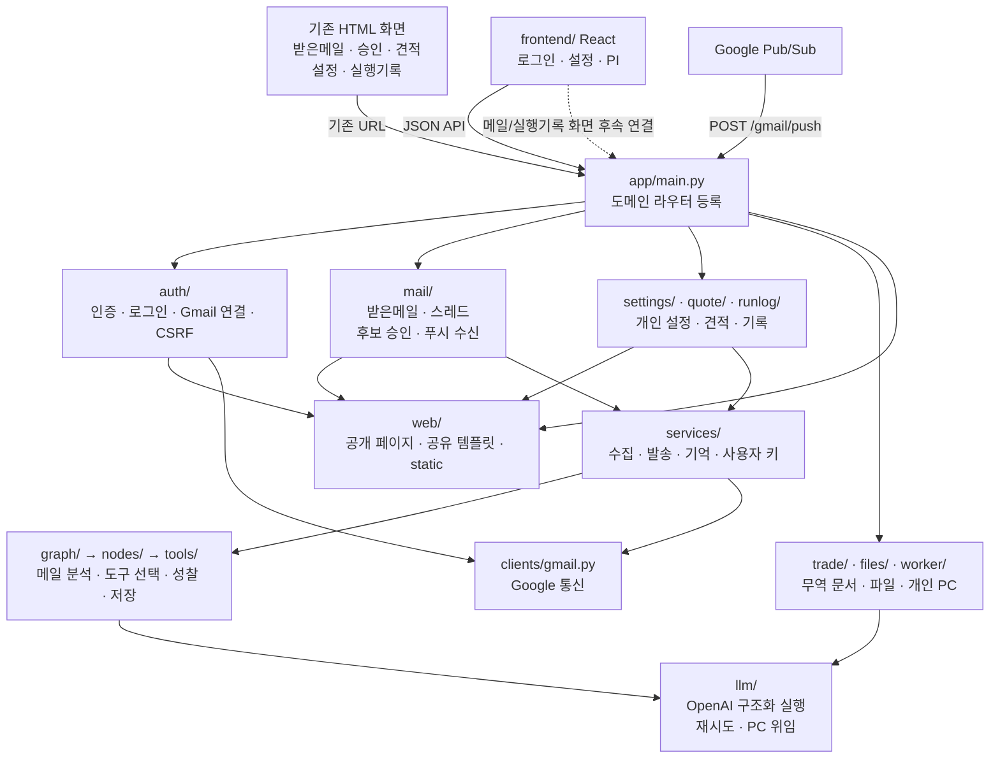

# 팀원용 도메인 구조와 파일 이동 안내

2026-11-13 기준. 관련 요구사항: R-01·R-02(기존 에이전트/도구 연결 유지), D-01·D-03(구조 설명과 코드 위치 안내). 이 변경은 파일 배치 정리이며 API·DB·그래프 상태·발송 규칙을 바꾸지 않는다.

## 1. 먼저 알아둘 점

새 사용자 화면은 루트 `frontend/`의 React/Vite 앱이다. `app/web/`은 기존 HTML 화면의 공유 자산·공개 안내 페이지와 React 빌드 정적 제공(`frontend.py`)을 담당한다. 기존 `web/routes/`의 업무 라우터와 `web/deps.py`를 각 도메인으로 이동했고, 옛 경로를 재수출하는 호환 파일은 남기지 않았다.

React 로그인·설정·PI는 연결돼 있지만 받은메일·실행기록은 아직 `PlaceholderPage`다. 계획 21.1절의 선행 작업으로 FastAPI가 `frontend/dist`를 `/app/`에서 제공하고 상세 주소를 복구한다. 전체 UI 검증은 21.2절, 운영 전환은 22절에 남아 있어 기존 템플릿·CSS·HTMX는 아직 사용 중이다. 새 UI가 있다는 이유만으로 이 자산을 지우면 메일 확인·승인·실행 기록 조회가 끊어진다. 도메인 정리 때 모든 페이지·컴포넌트의 참조를 확인했고 제거할 미사용 템플릿은 없었다.

## 2. llm과 clients는 같은 코드인가?

서로 다른 일을 하므로 통합하지 않았다. 둘 다 외부 API와 관련 있지만 호출 대상과 책임이 다르다.

| 구분 | `app/llm/client.py` | `app/clients/gmail.py` |
|---|---|---|
| 대상 | OpenAI Responses API | Google OAuth·Gmail·Pub/Sub 토큰 검증 |
| 진입점 | `call_structured()` | `GoogleClient`·`decode_message()` |
| 하는 일 | 프롬프트 처리, Pydantic 출력 검증, 오류 분류/재시도, 사용자 키 범위, 개인 PC 위임 | 로그인 주소/코드 교환, 토큰 갱신/폐기, Gmail 읽기·감시·메시지 해석 |
| 사용자 키/토큰 업무 | `services/openai_keys.py` | `services/auth.py`·`services/watch.py` |
| 주요 사용처 | 그래프 노드·도구·기억 요약·무역 추출·worker | 인증·메일 수집·메일 발송·평가 실행기 |
| 시험 대역 | `tests/fakes/llm.py` | `tests/fakes/google.py`·`gmail.py` |

AI 호출은 이미 `call_structured()` 한 곳에 모여 있다. 여기서 SDK 자동 재시도를 끄고 기존 예산에 따라 실행하거나 개인 PC로 위임한다. Gmail 처리는 Google 클라이언트를 사용한다. 폴더를 합쳐도 공통으로 제거할 구현은 없다.

## 3. 현재 구조 모형도

실선은 코드 호출/자산 사용, 점선은 앞으로 연결할 화면이다. React가 준비됐다는 뜻과 운영 배포가 연결됐다는 뜻은 다르다.

`auth`·`mail`·`settings`·`quote`·`runlog`의 HTML 응답은 같은 Jinja 템플릿을 사용한다. 조회·승인·키 관리 등의 처리는 해당 도메인에 두고, `web`은 렌더링 자산만 제공한다. 실제 수집·발송·기억 서비스의 기존 위치는 유지했다.

## 4. 파일을 어디서 찾으면 되나?

| 고치려는 기능 | 위치 | 대표 URL |
|---|---|---|
| Supabase 인증·사용자 매핑 | `app/auth/supabase.py`, `router.py` | `/api/me` |
| 기존 Google 로그인·콜백·로그아웃 | `app/auth/session.py` | `/login`, `/auth/google/*`, `/logout` |
| 공통 사용자 인증·세션 폼 CSRF 검사 | `app/auth/deps.py` | 다른 도메인이 import하는 의존성 |
| Gmail 연결·해제 | `app/auth/gmail.py` | `/api/gmail/*` |
| 받은메일 목록·HTMX 갱신 | `app/mail/inbox.py` | `/inbox`, `/inbox/list` |
| 스레드·답장 후보·명시적 발송 승인 | `app/mail/candidates.py` | `/threads/*`, `/candidates/*/approve` |
| Gmail 푸시 수신/인증 | `app/mail/push.py` | `/gmail/push` |
| 국내 견적 조회·단가 보완·PDF·발송 승인 | `app/quote/router.py` | `/quotes/*` |
| 개인 키·성찰·국내 회사/단가 설정 화면 | `app/settings/router.py` | `/settings`, `/settings/*` |
| 무역 회사·거래처·계좌·단가·이미지 설정 API | `app/trade/settings/` | `/api/trade/settings/*` |
| 개인 PC 연결·실행 모드 | `app/worker/router.py` | `/api/ai-execution/*`, `/settings/worker/*` |
| 실행 기록 목록·상세·마스킹 내보내기 | `app/runlog/router.py` | `/runs`, `/runs/*` |
| PI·PO·CI·PL 문서 | `app/trade/{pi,po,ci,pl}/` | `/api/trade/{pi,po,ci,pl}` |
| 공개 안내·약관 | `app/web/pages.py` | `/about`, `/privacy`, `/terms` |
| 기존 HTML 모양·공통 조각 | `app/web/templates/`, `static/` | `/static/*` |
| 새 React 화면 | `frontend/src/`·`app/web/frontend.py` | 개발은 Vite, 빌드 후 FastAPI의 `/app/*` |

`settings`는 기존 개인/국내 견적 설정의 HTTP 진입점이고, `trade/settings`는 무역 문서 기준 설정이다. 회사/단가가 일부 DB 모델을 공유하더라도 국내 원화와 무역 Decimal/역할별 단가 규칙이 달라 업무 로직을 합치지 않았다.

## 5. 이번에 이동·삭제한 것

| 이전 위치 | 현재 위치 |
|---|---|
| `app/web/deps.py` | `app/auth/deps.py` |
| `app/web/routes/auth.py` | `app/auth/session.py` |
| `app/web/routes/inbox.py` | `app/mail/inbox.py` |
| `app/web/routes/candidates.py` | `app/mail/candidates.py` |
| `app/web/routes/gmail_push.py` | `app/mail/push.py` |
| `app/web/routes/quotes.py` | `app/quote/router.py` |
| `app/web/routes/settings.py` | `app/settings/router.py` |
| `app/web/routes/runs.py` | `app/runlog/router.py` |
| `app/web/routes/pages.py` | `app/web/pages.py` |

옛 `web/routes/__init__.py`도 삭제했다. `worker`가 설정 화면 모듈을 import하던 CSRF 검사 함수는 `auth/deps.py`의 `check_session_csrf()`로 옮겨 개인 키 폼과 PC 승인 요청이 함께 사용한다. 전체 앱/테스트의 import와 최신 계약·파일 지도도 새 위치로 맞췄다. 이전 계획·시험 기록에 나오는 옛 경로는 작성 당시 이력이므로 위 표로 찾으면 된다.

## 6. web에 남긴 자산과 향후 정리 조건

| 남긴 것 | 현재 필요한 이유 | 대체 확인 조건 |
|---|---|---|
| 받은메일·스레드·후보 템플릿 | React 메일 화면은 아직 미연결 | 전환 계획 19절: 본인 조회·승인 1회 발송·무역 문서 연결 확인 |
| 실행 기록 템플릿 | React 실행기록 화면은 아직 미연결 | 20절: 본인 기록/마스킹 내보내기 확인 |
| 로그인·설정 템플릿 | 기존 세션/CSRF 경로, 로컬 실행, 개인 PC 승인 절차에서 사용 | 기존 기능 대체와 21.2·22절 통합 검증/운영 전환 확인 |
| 국내 견적 템플릿 | React 전환 계획도 기존 원화 견적 화면을 유지 | 동일 계산·미리보기·승인/첨부 발송 경로 대체 확인 |
| 공개 소개·약관·개인정보 페이지 | Google OAuth 브랜딩 링크와 공개 접근에 사용 | 주소 유지 및 동등한 공개 페이지 확인 |
| 공통 조각·CSS·HTMX·라이선스 | 위 화면에서 모두 참조 | 모든 사용처 대체 후 참조가 없는 자산만 제거 |

도메인 정리와 21.1절 빌드/제공 기반만으로 전체 UI 통합 검증(21.2절), 실제 운영 전환(22절), 무역 후보의 화면 연결 누락(19절)을 완료 처리하지 않는다. 상세 현재 상태와 선행 작업은 [전환 진행 현황](plans/react-supabase/PROGRESS.md)과 [전환 계획](plans/react-supabase/PLAN.md)을 따른다.

## 7. 검증과 팀원 인계

이동 전후에 등록 URL·HTTP 메서드·라우트 이름과 OpenAPI 명세를 대조하고, 기존 인증/사용자 격리·CSRF·메일 승인·Gmail 수신·개인 PC·문서 발급 회귀 시험을 실행한다. 최종 실행 결과는 이 변경의 PR `확인 결과`에 기록한다. 실제 OpenAI·Google 계정·운영 DB/Storage 검증은 자동 시험과 구분한다.

다음에 받은메일 UI를 연결할 때는 `web/routes`를 복원하지 않고 `mail`의 HTTP 진입점과 기존 `services` 업무를 사용한다. 기존 스레드의 무역 후보 문서 링크 누락도 19절의 확인 대상으로 남아 있다. 실행 기록 API/UI 연결은 `runlog`에서 이어가면 된다.

발표용 설명: 화면과 업무 처리의 파일 위치를 분리했다. 새 React UI는 JSON API를 호출하고, 기존 HTML 화면의 라우터는 각 업무 도메인에서 같은 템플릿을 사용한다. OpenAI 실행과 Google 통신은 책임이 달라 분리해 두었으며, 새 화면으로 아직 대체되지 않은 기능은 유지했다.
