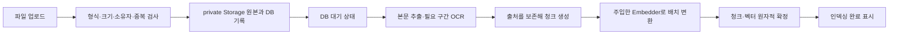

# 문서 업로드·OCR·청크·임베딩 저장 계획

- 목표: 개인 문서를 업로드하면 원본은 기존 비공개 Storage에 보관하고, 텍스트 추출·OCR·청크 생성·임베딩을 거쳐 기존 PostgreSQL의 pgvector에 저장한다. 이번 완료 지점은 저장 결과와 처리 상태를 문서 화면에서 확인하는 것이다.
- 기준: 2026-11-13, upstream main `6058b19`. 이 PR은 계획만 추가하며 기능 구현·실제 문서 업로드·외부 AI 호출·운영 설정 변경은 하지 않는다.
- 사용자 확정: 기존 PostgreSQL + pgvector 사용, 업로드 화면과 OCR·청크·임베딩까지 구현, OCR과 임베딩 공급자/모델을 각각 교체할 수 있게 추상화한다.
- 관련 Issue: #177~#183(아래 작업표). 모든 하위 작업은 아직 미착수다.
- 관련 요구사항: R-07·R-08의 문서 컨텍스트 기반 준비, R-11의 실패/재시도, R-14의 사용자 화면. 실제 API 확인은 R-04·R-12에 별도 기록한다. 이 저장 기능만으로 그래프 검색·기억 활용이나 전체 과제 요구사항이 완료된 것은 아니다.
- 조율함: 해당 없음(이번은 계획 문서). 후속 DB·Storage·배포 변경은 공통 기반 담당, 파서 재사용 범위는 문서 추출 담당과 조율한다. 그래프 상태·도구 스키마·노드/엣지는 이번 범위에서 변경하지 않는다.

### 포함 범위와 아직 정하지 않은 것

| 구분 | 내용 | 상태 |
|---|---|---|
| 저장소 | 기존 PostgreSQL에 pgvector, 기존 private Storage와 `file_assets` 재사용 | 사용자 선택/기존 기반 |
| 코드 위치 | 백엔드 `app/knowledge/`, 프론트 `frontend/src/knowledge/`, 화면 `/app/knowledge` | 계획 기본안 |
| 교체 경계 | `OcrEngine`과 `Embedder`를 독립 Protocol로 정의하고 생성 시 주입 | 사용자 요청 |
| OCR 기본 구현 | Tesseract + 한국어/영어 데이터, 서버 내부 실행을 추천 | 미확정, 2절에서 선택 |
| 임베딩 기본 구현 | 기존 사용자 OpenAI 키 + `text-embedding-3-small`을 첫 후보로 추천 | 미확정, 2절에서 선택 |
| 원본 취급 | 본인 문서만 처리하고 브라우저가 업무 DB/Storage에 직접 쓰지 않음 | 기존 인증 정책 재사용 |
| 첫 지원 형식 | PDF·DOCX·XLSX·TXT·PNG·JPEG 제안 | 1·2절에서 확정 |
| HWP | 첫 버전은 PDF로 변환 후 업로드하는 안을 추천. 원본 HWP 직접 파서는 지원하기로 확정되지 않음 | 사용자 확인 필요, 성공으로 표시하지 않음 |
| 자원 한도 | 파일 20MiB, PDF 50페이지, 이미지 2천만 픽셀, 압축 해제 합계 100MiB, 추출 텍스트 100만 자를 초기 상한으로 제안 | 제품 기본안, 1절에서 확정·문서화 |

- 기존 무역 문서 첨부 `/api/files`의 5MiB·형식 제한은 그대로 두고 지식 문서 업로드에 별도 검증을 둔다. 동일 버킷의 크기/MIME 제한은 서버 검증과 별개라 2절에서 함께 확인한다.
- 제외: 문서 검색 API/하이브리드 검색, LangGraph 연결, 이메일 초안/발송 변경, 필수 항목 근거 표시, 팀 공유·초대, 자동 버전 추정, 별도 벡터 DB 서비스. 기존 `gmail-quote-mvp.md` 21·22절의 규칙 근거 RAG를 대체하거나 완료 처리하지 않는다.
- 사용자 로컬 폴더 조사에서 29개 파일, PDF 18개 중 텍스트가 추출되지 않는 이미지 문서 12개, 완전 중복 2쌍을 확인했다. 이는 읽기 진단이며 전체 OCR 품질 검증이 아니다. 원본/추출 내용/실제 이름·연락처를 레포·Issue·시험 자료로 복사하지 않는다.
- 현재 앱에는 OCR 파이프라인이 없다. 로컬 샘플은 macOS Apple Vision으로 확인했으며 Linux 운영 서버에서 쓸 엔진을 검증한 결과가 아니다. 로컬 Tesseract의 설치 언어는 `eng`·`osd`뿐이고, 운영 서버의 엔진·한국어 데이터 설치 상태는 미확인이다.

### 폴더와 책임

아래는 구현할 때 만들 파일의 목표 위치다. 계획 PR에서 빈 패키지나 실행 파일을 먼저 생성하지 않는다.

```text
app/knowledge/
  router.py          # Bearer 인증·HTTP 입출력, 의존성 조립
  operations.py      # 업로드/처리/재처리 업무 흐름
  schemas.py         # 요청·응답, 추출 구간·청크·프로필 값
  ports.py           # OCR·임베딩·저장소에 필요한 작은 Protocol
  repository.py      # 문서/청크 ORM과 SQL, pgvector 저장
  extract.py         # 형식별 추출, 필요한 페이지의 OCR 어댑터
  chunking.py        # 조항/문단 우선 분할, 출처 위치 보존
  embeddings.py      # 선택한 임베딩 공급자의 어댑터
  worker.py          # PostgreSQL 대기 문서를 가져와 처리
frontend/src/knowledge/
  KnowledgePage.jsx  # 업로드·목록·상태·추출문/청크 확인
  api.js             # 기존 공통 fetch를 재사용하는 도메인 요청
tests/               # 기존 pytest 구조 안에 test_knowledge_*.py
```

- `router → operations → 저장소 Protocol`을 지킨다. operations는 구체 SQLAlchemy/Storage/OCR SDK를 import하지 않는다. repository는 구체 DB를 소유하며 OCR/임베딩 어댑터는 라이브러리 결과를 공통 값으로 변환한다. Protocol과 함수 주입으로 실제 구현·가짜 구현을 바꾸되 범용 CRUD 기반 클래스, 플러그인 자동 탐색, 공급자별 전체 계층은 만들지 않는다.
- 기존 `app/files/storage.py`의 `StorageClient`, 인증/정수 사용자 매핑, SQLAlchemy 엔진·Alembic, React 로그인·공통 API를 재사용한다. 스키마 갱신·앱 라우터 등록·화면 메뉴 등 연결 지점은 기존 위치에서 최소 수정한다.
- 이번은 RAG 중 인덱싱 `Load → Split → Embed → Store`만 구현한다. LangGraph CLI 스킬은 검토했지만 별도 Agent Server를 만드는 도구이므로 `langgraph new/dev/up`, 새 `langgraph.json`, Redis·Celery·새 배포 서비스를 추가하지 않는다.

### 처리 흐름과 실패 의미



- 업로드 요청에서는 OCR/임베딩이 끝날 때까지 기다리지 않는다. 원본과 문서·대기 기록 확정 후 `202`와 `document_id`를 반환한다. 동일 소유자·원본 SHA-256 중복은 기존 문서/상태를 반환하며 새 작업이나 과금을 발생시키지 않는다. 사용자 사이에서는 중복 존재를 알리지 않는다.
- 문서 행의 `status`는 `queued → extracting → chunking → embedding → ready`, 실패는 `failed`로 정한다. 실패에는 안전한 `error_code`와 단계만 남긴다. 업로드 완료를 인덱싱 완료로 표시하지 않는다. 재처리는 같은 문서의 새 `attempt_id`로 명시적으로 요청한다.
- 작업 큐는 별도 서비스 없이 PostgreSQL 문서 행을 쓴다. 프로세스별 동시 처리 1개로 시작하고 SQL claim·임대·시도 ID로 다른 프로세스/늦게 온 결과의 덮어쓰기를 막는다. 재시작으로 임대가 만료되면 중단을 표시하고 사용자가 재시도한다. 외부 호출이 진행됐을 수 있는 작업을 무조건 자동 재배포하지 않는다.
- DB 트랜잭션을 OCR/외부 API 대기 동안 열어 두지 않는다. 새 청크/벡터는 검증된 한 시도의 결과 전체를 DB에 함께 확정하고, 일부 성공을 `ready`로 만들지 않는다. 재처리 성공 전에는 이전 성공 결과를 지우지 않는다. 마지막 확정은 현재 시도 ID를 재검사한다.
- `knowledge_documents`가 원본 `file_assets.id`를 제한 외래 키로 참조한다. Storage 경로는 기존 `{user_id}/attachments/{uuid}`를 재사용한다. 새 원본도 기존 미참조 객체 정리에서 참조로 인식되며, 지식 문서가 참조 중인 파일의 직접 삭제는 차단한다. Storage 성공 뒤 SQL 롤백으로 남은 객체는 기존 정리 절차로 처리한다.
- 원본 다운로드·상태·추출문·청크·재처리 모두 서버가 소유자를 확인한다. 요청의 user_id/모델 이름/임의 endpoint/실행 명령을 그대로 신뢰하지 않는다. 임시 파일·OCR subprocess·압축 해제에 한도와 timeout을 두고 작업 뒤 정리한다. 문서 원문/키/외부 오류 본문은 로그에 남기지 않는다.

### OCR·임베딩 교체와 저장 형식

- `OcrEngine.recognize(image, language) → OcrPage`는 텍스트·공급자/엔진/모델 버전·경고를 반환한다. `Embedder.embed_documents(texts) → EmbeddingBatch`는 입력 순서에 대응하는 벡터와 공급자/모델/리비전/차원/정규화 프로필을 반환한다. 둘은 서로 의존하지 않는다. 구체 메서드/값 타입은 1절이 계약 문서에 확정한다.
- 공급자 선택은 서버 설정의 허용 목록과 명시적 의존성 주입으로 한다. 기본 설정을 바꾼 뒤 생성/재처리하는 작업에 적용하고, 작업 시작 시 프로필을 고정해 처리 중 설정 변경이 한 문서에 섞이지 않게 한다. 필요 없는 두 번째 실제 공급자는 미리 구현하지 않으며 두 개의 가짜 공급자로 교체 가능성을 시험한다.
- 문서는 OCR 프로필·추출/청크 알고리즘 버전·현재 성공한 처리 시도·임베딩 프로필을 보존한다. 청크에는 문서/소유자, 순번, 텍스트/해시, 페이지 또는 문단·표/시트·행/셀 위치, 임베딩 프로필 식별자·차원을 남긴다. TXT/DOCX에 검증하지 않은 PDF 페이지 번호를 붙이지 않는다.
- 벡터 열은 차원을 고정한 `vector(1536)` 대신 `vector`로 제안하고, 행의 차원과 `vector_dims(embedding)` 일치·유한 숫자·프로필 일관성을 검증한다. 다른 모델/차원의 저장은 가능하지만 같은 의미 공간이 된 것은 아니다. 훗날 검색은 소유자와 동일 임베딩 프로필로 범위를 고정해야 한다. 이번에는 HNSW/IVFFlat 인덱스와 검색 API를 만들지 않는다.
- 같은 차원이어도 모델/정규화/전처리가 다르면 다른 프로필이다. 모델 변경이 기존 벡터를 자동 변환하지 않으며 기존 문서는 원문/청크로 명시적 재임베딩한다. 새 결과 전체 성공 시에만 이전 결과와 프로필을 함께 교체한다. 임베딩 응답 개수·순서·차원 불일치와 NaN/Infinity를 거부한다.
- OpenAI 어댑터를 선택하면 현재 `UserKeyAccess`의 소유자/실행 모드 검증을 재사용한다. 구조화 Responses 호출을 임베딩 호출로 가장하지 않는다. 서버 공용 키로 대체하지 않으며 PC `local_worker` 프로토콜에는 임베딩이 없으므로 미지원 상태를 명시한다. PC 프로토콜 확장은 이 계획에 넣지 않는다.

### 청크와 화면 기본안

- 텍스트 PDF는 페이지별로 먼저 추출한다. 텍스트가 없거나 이미지 부분에 읽을 내용이 남은 혼합 페이지는 OCR 대상으로 판정하고, 기존 텍스트와 OCR을 중복 덧붙이지 않는다. 표지·서명 페이지처럼 문자가 적은 경우와 누락을 구분해 경고한다. 판단 기준·OCR 결과가 비어 있는 경우를 시험한다.
- Word는 문단과 표의 문서 내 순서를 보존한다. Excel은 셀/행·헤더와 시트 위치를 보존하고 수식의 캐시 결과가 없으면 임의 계산값을 만들지 않는다. 처음부터 LLM으로 계약서 내용을 다시 작성하거나 자동 법률 판단을 하지 않는다.
- 분할은 조항/문단/표를 우선하고 긴 구간에만 `RecursiveCharacterTextSplitter`를 적용한다. 초기값은 1,000자/겹침 150자로 제안하며 문자와 토큰을 혼동하지 않는다. 공급자 입력 토큰 한도도 어댑터에서 확인한다. 조항 제목·예외·원본 위치가 유실되지 않게 한다.
- 화면은 다중 파일 선택/개별 업로드, 본인 문서 목록, 처리 상태/실패 이유, 추출문·출처·청크 수·임베딩 프로필 확인, 실패 재시도·명시적 재처리를 제공한다. 진행 상태는 문자로 표시하고 처리 중일 때만 폴링한다. 검색창이나 이메일 버튼은 이번에 넣지 않는다. 기존 무역 문서함 `/app/documents`와 충돌하지 않는 메뉴 이름은 `지식 문서`로 제안한다.

### 작업표

| 절 | 작업 | 선행 작업 | 담당 | Issue |
|---|---|---|---|---|
| 1 | 수집 계약과 교체 경계 확정 | 없음 | Codex | [#177](https://github.com/encore-ai-campus/aio-03-p2-team3/issues/177) |
| 2 | 기본 공급자·실행 환경 선택 | 없음 | 사람 | [#178](https://github.com/encore-ai-campus/aio-03-p2-team3/issues/178) |
| 3 | pgvector 저장소·실제 DB 시험 기반 | 1 | Codex | [#179](https://github.com/encore-ai-campus/aio-03-p2-team3/issues/179) |
| 4 | 지식 문서 업로드·상태 API | 3 | Codex | [#180](https://github.com/encore-ai-campus/aio-03-p2-team3/issues/180) |
| 5 | 텍스트 추출과 OCR 어댑터 | 1, 2 | Codex | [#181](https://github.com/encore-ai-campus/aio-03-p2-team3/issues/181) |
| 6 | 청크·임베딩 인덱싱 처리 | 2, 4, 5 | Codex | [#182](https://github.com/encore-ai-campus/aio-03-p2-team3/issues/182) |
| 7 | 문서 업로드 화면과 종단 간 확인 | 6 | Codex | [#183](https://github.com/encore-ai-campus/aio-03-p2-team3/issues/183) |

## 1. 수집 계약과 교체 경계 확정

- 할 일: 이 절만 수행한다. `docs/CONTRACT.md` 18절을 지식 문서 수집 계약으로 추가해 아래 독립 실행 기준의 HTTP 경로, OCR/임베딩/저장소 Protocol, 값 타입, 상태·오류·자원 제한, 출처, 프로필/시도 ID와 DB 표를 확정한다. 코드 위치는 `app/knowledge/`와 `frontend/src/knowledge/`, 화면은 `/app/knowledge`다. 기본 공급자 선택 전에는 추천을 확정 선택으로 쓰지 않는다. 뒤 하위 작업은 이 계약 18절을 읽는다.
- 완료 기준: 업로드·중복·재처리·실패·모델/차원 교체의 입출력과 상태가 명확하며, 기존 파일 참조·키·DB 시작/마이그레이션 순서와 충돌하지 않는다. 그래프나 새 공급자 호출은 없다. 규칙 검사와 전체 pytest 통과.
- 영향받는 상태·도구·노드: 신규 지식 문서 계약만. 기존 AgentState·WorkflowState·도구 스키마·노드/엣지 변경 없음.
- 섞지 않을 것: 실행 패키지/빈 폴더 생성, 스키마/서버/UI 구현, 실제 계정 설정, 검색/메일 연결.
- 선행 작업: 없음(이 계획 PR 병합 후).
- 하는 사람: Codex

이 절의 독립 실행 기준:

- 범위는 업로드→본문 추출/필요 구간 OCR→청크→임베딩→기존 PostgreSQL pgvector 저장/상태 화면이다. 검색·LangGraph/메일 연결·공유는 제외한다. 기존 인증/StorageClient/file_assets/DB 엔진·Alembic/React 공통 fetch를 재사용한다.
- router는 HTTP와 조립, operations는 업무 흐름, repository는 SQL/ORM을 맡는다. operations는 구체 SDK/DB를 import하지 않는다. `OcrEngine.recognize(image, language)`와 `Embedder.embed_documents(texts)`를 독립 Protocol로 주입하고 텍스트·출처·경고 및 순서가 보존된 벡터/공급자·모델·리비전·차원/정규화 프로필을 반환한다. 실제 두 번째 공급자나 범용 CRUD 계층은 만들지 않는다.
- API 기본 경로는 `/api/knowledge/documents`다. Bearer로 얻은 정수 소유자를 모든 조회/다운로드/처리 요청에서 검사하고 업로드는 원본+DB 대기 확정 후 202다. 동일 소유자+SHA-256은 기존 문서를 반환한다. 원본은 기존 attachments 경로의 file_assets로 저장하고 지식 문서가 제한 외래 키로 참조한다.
- 최초 형식은 PDF/DOCX/XLSX/TXT/PNG/JPEG, HWP는 PDF 변환 후 업로드를 제안한다. 한도 초안은 파일 20MiB/PDF 50페이지/이미지 2천만 픽셀/압축 해제 100MiB/텍스트 100만 자이며 확정 여부를 계약에 구분한다. 기존 첨부 5MiB 정책을 바꾸지 않는다. 표/문단 순서와 실제 페이지·시트/셀 출처를 보존하고 청크는 조항/문단 우선, 긴 구간 1,000자/겹침 150자를 제안한다.
- DB는 지식 문서와 청크 두 표, 문서 행의 작업 상태/claim/임대/attempt_id로 시작한다. 상태는 queued/extracting/chunking/embedding/ready/failed다. 작업 대기 중 DB 트랜잭션을 유지하지 않고 모든 벡터 검증 뒤 현재 시도의 결과만 원자적으로 확정한다. 재처리 실패 때 이전 성공 결과를 보존하고 만료 작업은 자동 과금 재실행 없이 명시적 재시도로 복구한다.
- 차원이 고정되지 않은 vector와 행의 차원/프로필 제약을 사용한다. 같은 차원이어도 다른 모델은 다른 프로필이며 모델 변경 때 기존 문서를 명시적으로 재처리한다. 한 시도의 OCR/임베딩 프로필은 고정한다. 기본 OCR/임베딩은 미확정이고 Tesseract kor+eng/사용자 키 OpenAI는 후보뿐이다. 미지원 local_worker는 서버 공용 키로 대체하지 않는다. 실제 문서/키는 레포·시험·로그에 넣지 않는다.

## 2. 기본 공급자·실행 환경 선택

- 할 일: OCR 엔진/모델과 임베딩 공급자/모델, 실제 문서의 외부 전송 범위, 초기 형식/HWP 변환안을 결정한다. 서버 내부 OCR을 선택하면 Linux에서 엔진·한국어 데이터·페이지 렌더러를 설치할 방법과 메모리 한도를 확인한다. 기존 native Render 빌드에 엔진이 있다고 가정하지 않고, Docker 전환 등 별도 배포 변경이 필요하면 범위를 먼저 정한다. 실제 DB의 vector 확장 설치 가능 여부와 Storage의 크기/MIME 제한도 확인한다. 선택 결과는 실제 키 없이 `.work/design/api-choice.md`와 이 절에 남기는 PR로 공유한다.
- 완료 기준: 공급자·모델·차원/버전·키 사용 위치·OCR 언어/실행 환경·외부 전송 여부·지원 형식과 필요한 운영 설정이 기록된다. 유료 서비스/실제 문서 호출은 사람의 확인 범위로 구분하고 모의 시험을 운영 완료로 쓰지 않는다. 비밀값은 기록하지 않는다.
- 영향받는 상태·도구·노드: 공급자/실행 환경 선택. 그래프 변경 없음.
- 섞지 않을 것: 실제 문서의 일괄 업로드, 운영 DB 변경/배포 전환을 이 문서 작성으로 완료 처리하기, 신규 에이전트 서버.
- 선행 작업: 없음(1절과 독립적으로 결정 가능).
- 하는 사람: 사람

## 3. pgvector 저장소·실제 DB 시험 기반

- 할 일: 1절이 확정한 계약을 읽고 `app/knowledge/repository.py`와 필요한 값/포트, 기존 Alembic 위치에 `knowledge_documents`/`knowledge_chunks`·외래 키·소유자/중복/시도 제약과 vector 확장을 추가한다. 현재 `Base.metadata.create_all()`이 Alembic보다 먼저 실행되므로 새 vector 표보다 확장이 먼저 준비되게 순서를 검증한다. Supabase auth/storage 스키마는 변경하지 않는다. PostgreSQL 16인 CI에 호환되는 pgvector를 준비하고 로컬 pgserver·Windows worker 검사에서 확장 의존성을 충족하는 실행 경로를 함께 정리한다. 버전/패키지/시험 이미지 선택은 구현 때 확인해 고정한다.
- 완료 기준: 실제 pgvector가 있는 임시 PostgreSQL에서 빈 DB/기존 DB 갱신·재실행·기존 데이터 보존, `vector` 저장과 `vector_dims`, 모델/차원 교체, 소유자/외래 키/중복/실패 롤백을 검증한다. 확장 누락을 가짜 배열이나 skip으로 숨기지 않는다. DB 통합 시험이 필수 CI에서 실행되고 기존 Linux/Windows 검사와 `python3 .work/check.py`·`uv run pytest`가 통과한다.
- 영향받는 상태·도구·노드: 신규 지식 문서/청크 저장과 시험 DB 준비. 기존 그래프 변경 없음.
- 섞지 않을 것: 업로드 API·OCR·외부 임베딩·검색 인덱스·운영 데이터 이전.
- 선행 작업: 1.
- 하는 사람: Codex

## 4. 지식 문서 업로드·상태 API

- 할 일: 1절이 남긴 계약을 읽고 `router.py`/`operations.py`와 저장소 메서드로 `/api/knowledge/documents` 업로드·목록·상세/추출 결과·원본 다운로드·처리 요청을 구현한다. Bearer에서 소유자를 얻고 지식 문서 전용 형식·한도 검증 뒤 기존 Storage와 `file_assets`를 재사용한다. 원본과 지식 문서 참조·대기 상태를 함께 확정하고 중복 요청은 기존 문서를 돌려준다. 참조 중 파일 직접 삭제를 차단하며 재처리 요청은 시도 권한/중복을 확인한다.
- 완료 기준: 정상 업로드 후 202와 본인 문서 상태가 보이고 원본 다운로드 해시가 같다. 다른 사용자 404·빈/위장/초과/미지원 파일·동시 중복·Storage 실패·SQL 실패·중복 처리 요청·파일 직접 삭제 거부를 실제 임시 DB와 가짜 Storage로 확인한다. 기존 `/api/files` 한도/의미는 보존된다. 규칙 검사와 전체 pytest 통과.
- 영향받는 상태·도구·노드: 지식 문서의 queued/failed 및 처리 요청 상태, 원본 파일 참조. 그래프 변경 없음.
- 섞지 않을 것: OCR·임베딩 실행, UI, 무역 첨부 제한 일괄 확대, 팀 공유.
- 선행 작업: 3(1절 계약 포함).
- 하는 사람: Codex

## 5. 텍스트 추출과 OCR 어댑터

- 할 일: 1절 계약과 2절 선택 기록을 읽고 `extract.py`에서 확정 형식의 원문/표 순서와 출처 구간을 추출한다. `OcrEngine`은 독립 주입하며 선택한 첫 실제 어댑터만 만든다. Tesseract를 선택했다면 렌더러·엔진·kor/eng 데이터 준비/점검 명령을 제공하고 macOS Vision을 Linux 서버 기본값으로 사용하지 않는다. 설정에 따른 OCR 교체와 빈/부분/혼합 페이지 판정, timeout/압축/페이지·이미지 자원 제한을 처리한다.
- 완료 기준: 합성 문서로 텍스트 PDF·스캔·혼합 페이지·표가 포함된 Word/Excel·손상/암호화/빈 문서와 출처 순서를 확인한다. 가짜 OCR 두 개를 바꿔도 같은 operations 입출력을 지키며, 선택한 실제 엔진으로 한글/영문 합성 이미지와 timeout/엔진·언어 미설치 오류를 직접 시험한다. OCR confidence를 정확도 수치로 쓰지 않는다. 규칙 검사와 전체 pytest 통과.
- 영향받는 상태·도구·노드: 추출 구간·OCR 프로필/경고/실패. 기존 그래프 변경 없음.
- 섞지 않을 것: 임베딩·DB 큐 실행·이메일 내용 추출 정책 변경·미선택 공급자/범용 변환기 구현.
- 선행 작업: 1, 2.
- 하는 사람: Codex

## 6. 청크·임베딩 인덱싱 처리

- 할 일: 1절 계약과 2절 공급자 결정을 읽고 `chunking.py`/`embeddings.py`/`worker.py`를 연결한다. 출처 구간을 조항/문단 우선으로 나누고 공급자 한도 안에서 `Embedder`를 호출한다. 기존 SDK/키 정책을 재사용하며 두 공급자 교체와 차원 변경은 어댑터 밖에서 처리한다. PostgreSQL claim/임대/시도 ID·명시적 재처리·새 결과 원자적 저장과 기존 앱 lifespan의 시작/정리를 연결한다. 선택한 OCR 런타임의 서버 설치/빌드 준비가 필요하면 2절에서 합의한 범위만 반영한다.
- 완료 기준: 실제 임시 pgvector DB와 가짜 OCR/임베딩으로 queued→ready, 외부 호출 실패→failed, 일부 배치 실패 때 부분 공개 금지, 재처리 실패의 이전 결과 보존, 같은 파일 중복 과금 방지, 오래된 시도의 덮어쓰기 차단, 재시작/임대 만료를 확인한다. 두 가짜 OCR과 두 임베딩 공급자/다른 차원으로 코어 수정 없이 교체하고 출처/프로필을 저장한다. 순서/개수/차원 불일치·NaN·빈 청크·미지원 PC 모드가 실패하며 서버 공용 키로 우회하지 않는다. 규칙 검사와 전체 pytest 통과.
- 영향받는 상태·도구·노드: 지식 문서 처리 상태·프로필·시도·벡터 결과와 앱 작업 생명주기. 기존 StateGraph 변경 없음.
- 섞지 않을 것: 검색 API·LangGraph CLI/그래프·메일/발송·Celery/Redis·실제 계약서 자동 적재.
- 선행 작업: 2, 4, 5.
- 하는 사람: Codex

## 7. 문서 업로드 화면과 종단 간 확인

- 할 일: 1절 계약을 읽고 기존 React 라우팅/레이아웃/공통 API로 `/app/knowledge`의 지식 문서 화면을 만든다. 파일별 업로드 결과·처리 중 상태·실패 안내/재시도·추출문/청크 출처·프로필/차원/완료 상태를 표시한다. 문서가 없거나 API 미설정이면 실제 상태를 안내하며 임베딩 공급자 비밀값은 화면으로 보내지 않는다. README에 서버 OCR 설치/기본 공급자 설정·실행/재시도·미지원 형식·검증 명령을 정리한다.
- 완료 기준: 실제 FastAPI·임시 pgvector PostgreSQL·가짜 Storage/공급자에서 업로드→상태 갱신→ready→청크/벡터/출처 확인을 브라우저로 완주한다. 실패/중복/다른 사용자/재시도/새로고침/모바일·키보드 접근도 확인한다. 선택한 실제 OCR 합성 문서 시험과 실제 외부 임베딩/운영 배포 확인을 구분하고, 후자는 사람 확인 없이는 미확인으로 남긴다. 프론트 lint/test/build와 규칙 검사·전체 pytest 통과.
- 영향받는 상태·도구·노드: 지식 문서 화면과 HTTP 연결. 그래프·검색·메일 연결 없음.
- 섞지 않을 것: 기존 문서함/메일 화면 재작성, 검색창·이메일 초안 기능, 운영 키 입력/실제 문서 일괄 업로드.
- 선행 작업: 6(4절 API 포함).
- 하는 사람: Codex

### 새 작업용 요청문

> Issue: #177. docs/plans/document-ingestion.md의 1절만 수행해 주세요. OCR·임베딩은 각각 교체 가능한 Protocol로 정하고 기존 Storage/file_assets·Bearer 인증·PostgreSQL을 재사용하는 수집 계약을 문서화해 주세요. 관련 상태는 신규 지식 문서 상태·시도 ID·출처·모델 프로필이며 기존 그래프 상태·도구·노드는 변경하지 않습니다. 수정 범위는 docs/CONTRACT.md 18절/이 계획 1절/최신 흐름 문서이며 실행 코드·새 공급자 선택·검색·메일 연결은 제외합니다. 완료 기준은 이 절의 정상/중복/실패/교체 조건이 계약에 명확하고 규칙 검사와 전체 pytest 통과 후 PR을 여는 것입니다.

### 공식 확인 자료

- [Supabase pgvector](https://supabase.com/docs/guides/database/extensions/pgvector): PostgreSQL vector 확장과 설치 위치. 운영 설치 상태 확인과 구분한다.
- [pgvector FAQ](https://github.com/pgvector/pgvector#frequently-asked-questions): 차원이 다른 벡터를 `vector` 열에 저장할 수 있으며 인덱스/검색은 같은 모델·차원으로 제한해야 한다.
- [LangChain RecursiveCharacterTextSplitter](https://docs.langchain.com/oss/python/integrations/splitters/recursive_text_splitter): 기본 분할 단위는 문자 수이며 겹침과 구분자를 지정한다.
- [pypdf 추출](https://pypdf.readthedocs.io/en/stable/user/extract-text.html): 이미지 PDF에는 OCR이 필요하며 파싱 메모리 한도를 고려한다.
- [Tesseract 설치](https://tesseract-ocr.github.io/tessdoc/Installation.html): 엔진과 언어 학습 데이터를 각각 설치한다. 서버 내부 OCR이 자동 제공되는 것은 아니다.
- [OpenAI 임베딩](https://developers.openai.com/api/docs/guides/embeddings): 임베딩 전용 API와 모델/차원. 후보 확인이며 사용자 선택 전에는 확정으로 쓰지 않는다.
- [LangGraph CLI](https://docs.langchain.com/langsmith/cli): Agent Server 실행/배포 도구. 이번 기존 FastAPI 인덱싱 기능에 별도 서버를 추가할 이유가 없다.
