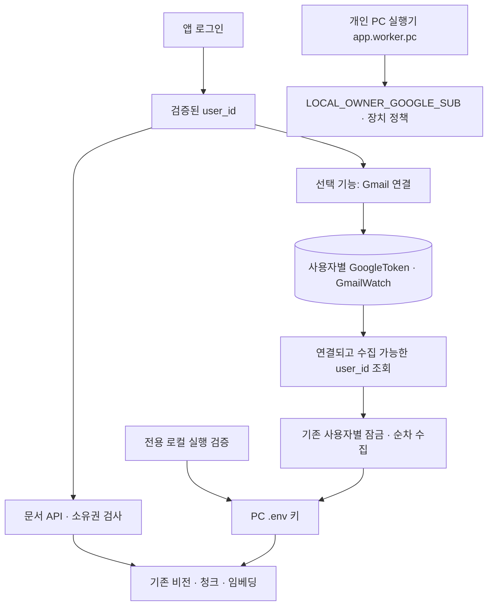

# local-runtime-simplification — 로컬 AI·Gmail 계정 결합 정리

- 목표: 로컬 AI는 PC의 `.env` 키를 사용하고, 로컬 Gmail은 연결·수집 상태가 유효한 `user_id`들을 처리한다. `LOCAL_OWNER_GOOGLE_SUB`는 HTTPS 서버에 연결하는 개인 PC 실행기(`app.worker.pc`) 전용으로 남긴다.
- 요청 근거: 2026-11-16, 사용자가 수동 Google 식별자 설정을 제거하고 Ponytail·Python Clean Architecture 기준으로 최소한의 구조 정리를 요청했다.
- 계획 기준: main `8ad74d9`. 각 절의 완료 표시는 해당 구현을 포함한 브랜치 기준이다. 1~3절에서 로컬 AI 계정 분리·연결된 user_id별 Gmail 수집·개인 PC 전용 설정과 화면 안내 정리를 구현했다. 실제 계정/운영 확인은 기존 #157·#178에서 별도로 수행한다.
- 관련 Issue: 1절 [#198](https://github.com/encore-ai-campus/aio-03-p2-team3/issues/198), 2절 [#199](https://github.com/encore-ai-campus/aio-03-p2-team3/issues/199), 3절 [#200](https://github.com/encore-ai-campus/aio-03-p2-team3/issues/200). 기존 실제 운영 확인 #157·#178과 별개이며 이를 완료 처리하지 않는다.
- 관련 요구사항: R-04·R-11·R-12·R-14. 새 그래프·검색 기능이나 외부 API를 추가하는 계획은 아니다.
- 조율함: 해당 없음 — 그래프 상태·도구 스키마·노드/엣지는 수정하지 않는다. 기존 인증·수집·키 조회의 호출 계약을 보존한다.

### 결정한 경계

| 책임 | 기준 | 하지 않는 일 |
|---|---|---|
| 앱 인증·문서 소유권 | 검증한 Supabase JWT 또는 기존 세션에서 얻은 내부 `user_id` | 클라이언트가 보낸 임의 사용자 ID를 신뢰하지 않음 |
| 로컬 AI 키 | 기존 전용 루프백 실행 검증 + `OPENAI_API_KEY` 존재 | Google 식별자·Gmail 연결·`last_login_at`을 요구하지 않음 |
| 로컬 Gmail 수집 | DB의 사용자별 연결·수집 상태 | 고정 Google 소유자, 현재 브라우저 세션, 이메일로 대상 선정하지 않음 |
| 서버 AI | 기존 사용자별 저장 키 또는 개인 PC 위임 | 서버 `.env` 키로 대체하지 않음 |
| 개인 PC 실행기 | `LocalPolicy`의 서비스·Google 소유자·장치·모델 검증 | 소유자 검사를 제거하거나 다른 사용자 작업을 허용하지 않음 |

로컬 앱 프로세스가 처리하는 AI 작업은 그 PC의 환경 키를 사용한다. 여러 Gmail 사용자 행을 처리해도 메일·문서·후보·커서의 소유권은 각각의 `user_id`로 구분한다. 수집 범위는 **이 로컬 수집기로 연결·활성화한 계정**이다. 같은 DB에 있다는 이유로 공용 서버의 Pub/Sub 계정을 가져오지 않는다.

초기 범위는 한 로컬 앱 프로세스의 순차 수집이다. 기존 사용자별 잠금과 메시지 중복 차단을 재사용하고, 여러 PC/프로세스의 분산 수집 보장을 위해 새 잠금·큐를 추가하지 않는다.



### 최소 구조

- HTTP 라우터·앱 시작 코드가 조립하고, 기존 서비스가 업무 흐름을 수행한다. 로컬 키 판별은 설정만 읽는 작은 함수로 분리하고 기존 `UserKeyAccess`/`user_openai` 진입점에서 재사용한다. 메일·문서·요약 호출자마다 새 분기를 만들지 않는다.
- 수집기의 SQL 조회·조건부 갱신은 작은 `app/db/local_gmail.py` 구현으로 모은다. 기존 `app/services/local_gmail.py`는 순차 수집·중단·오류 격리를 담당하고, 필요한 조회/갱신만 좁은 Protocol로 받는다. 반환은 `id`, `email`, `cursor`, `generation`, 연결 상태 등 처리에 필요한 값이며 ORM 세션을 밖으로 전달하지 않는다. 기존 `collect_history`가 쓰는 `id`/`email` 경계를 호환시켜 본문 처리 알고리즘은 복제하지 않는다.
- `app/main.py`에서 기존 수집기와 SQL 구현을 한 번 연결한다. 새 DI 컨테이너·범용 CRUD Repository·이벤트 버스·키 공급자 레지스트리를 만들지 않는다. 기존 서버 키 저장 계층과 모든 Gmail 업무를 전면 재배치하지 않는다.
- 새 테이블·마이그레이션·라이브러리·설정 스위치·자동 계정 등록·키 사용 승인 화면을 추가하지 않는다. 모델 교체 Protocol, 토큰 암호화, 데이터 소유권, 수집 중단/중복 방지는 유지한다.
- 기존 쿠키 로그인 제거, Supabase와 Gmail OAuth 통합, Gmail 연결의 중복 JWT 검증 정리는 이번 필수 범위에서 제외한다. React 메일 화면 전환이나 별도 인증 작업과 묶지 않는다.

## 1. 로컬 AI 키에서 Google 계정 의존 제거 (완료)

- 할 일:
  - `app/services/openai_keys.py`의 로컬 분기에서 `LOCAL_OWNER_GOOGLE_SUB`, `User.google_sub`, `last_login_at` 비교를 제거한다. 설정을 읽는 로컬 키 함수를 기존 코드 안에 두고, `UserKeyAccess`/`user_openai`의 외부 호출 계약을 유지한다. 서버 저장 키·PC 위임 분기를 별도로 새로 구현하지 않는다.
  - 키를 읽을 때 필요한 조건은 전용 로컬 실행 검증과 비어 있지 않은 환경 키다. `USER_NOT_FOUND` 등 사용자/자료 접근 권한은 검증된 인증·기존 업무 경계에서 유지한다. 로컬 키 읽기가 Google 토큰·DB 사용자 키를 조회하지 않게 한다.
  - 지식 문서 업로드·명시적 재처리에서는 원본 저장/작업 등록 전에 같은 키 접근 검사를 재사용하고, 작업 실행 직전에도 같은 함수를 호출한다. 실제 OpenAI 호출로 키 유효성을 시험하지 않는다. 진행 중 키 설정이 바뀌면 안전한 코드로 실패하고 이전 성공 결과를 보존한다.
  - 메일·무역 문서·요약과 지식 문서가 같은 로컬 키 경계를 사용함을 확인한다. 계약 6·18절과 이 절의 기대 동작을 맞춘다. 공용 서버의 환경 키 차단은 유지한다.
- 완료 기준:
  - Google 미연결 Supabase 사용자와 다른 정상 로그인 사용자도 로컬에서 기존 `.env` 키로 지식 문서/기존 AI 요청을 처리한다. 문서 소유권은 계속 사용자별이며 타인 자료는 보이지 않는다. 가짜 AI·실제 임시 PostgreSQL로 확인한다.
  - 키 누락(`LOCAL_KEY_REQUIRED`)·전용 실행 아님(`LOCAL_RUNTIME_REQUIRED`)이면 원본 업로드/작업 등록 전 차단한다. worker도 실행 시 같은 검사를 하며 기존 인덱스를 훼손하지 않는다.
  - 서버 키 누락·복호화 실패·PC 모드 실패는 서버 환경 키나 다른 사용자 키로 대체되지 않는다. 키·해시·일부 문자열은 응답/로그에 포함되지 않는다. 개인 PC 실행기의 소유자 불일치 차단도 유지된다.
- 영향받는 상태·도구·노드: 키 조회, 지식 문서 업로드/재처리의 설정 오류 시점. 기존 그래프 상태·도구 스키마·노드/엣지와 문서 처리 상태 이름은 변경 없음.
- 섞지 않을 것: Gmail 다계정 수집, 앱 공통 설정 필드 삭제, PC 실행기 정책 변경, 새 키 저장 방식·UI 승인 절차.
- 선행 작업: 없음 — 이 계획 PR 병합 후 시작. 2절과 독립적인 실행 코드이나 문서 충돌은 각 PR에서 통합한다.
- 하는 사람: Codex

## 2. 연결된 user_id 기준 로컬 Gmail 다계정 수집 (완료)

- 할 일:
  - `User`·`GoogleToken`·`GmailWatch`를 `user_id`로 연결해 수집 대상을 조회한다. 사용자 행 존재, 비어 있지 않은 갱신 토큰 암호문, `topic=local:history`, `status`가 `active` 또는 재시도 가능한 `error`인 계정을 대상으로 한다. `token_expired`·`history_expired` 등 기존 종료 오류, 미연결·중지·공용 Pub/Sub 행은 제외한다. 토큰이 실제 유효한지는 기존 갱신/Google 호출과 오류 처리에서 판단한다.
  - Google 식별자와 `last_login_at`으로 대상을 고르지 않는다. 브라우저가 닫혀도 저장된 연결·커서로 계속 수집한다. 프로세스 재시작 때 stopped를 자동 활성화하거나 새 사용자를 자동 연결하지 않는다.
  - 대상 목록을 안정적인 `user_id` 순서로 순차 처리하고 기존 `_mailbox_lock`을 재사용한다. 한 계정의 실패로 다음 계정을 건너뛰지 않는다. 병렬 실행·새 작업 큐·부하 분산은 추가하지 않는다.
  - 이 문서의 최소 구조대로 SQL 구현을 분리한다. 최초 대상 조회와 처리 중 `active()` 재검사는 같은 연결 조건을 사용한다. 메일/첨부 처리 전과 커서 갱신 때 토큰 존재·중지/연결 해제·종료 오류·연결 generation을 재확인한다. 해제·재연결 뒤 늦은 결과는 기존 조건부 갱신으로 거부한다.
  - 기존 history 페이지 처리·MIME 해석·중복 차단·후보 생성은 `collect_history`를 재사용한다. 명시적 연결 시 현재 history에서 시작하고 실패한 페이지/메시지는 커서를 진행하지 않는다. watch/stop/PubSub API를 로컬 수집에서 호출하지 않는다.
  - `app/auth/session.py`의 로컬 수집 상태 표시에서도 고정 소유자 안내를 없애고 같은 연결·수집 상태를 표시한다. 계약 10절과 기존 로컬 수집 계획 2절의 현재 동작 안내를 맞춘다.
- 완료 기준:
  - 서로 다른 Google 계정 A/B의 연결된 `user_id`를 한 번의 수집 주기에서 각각 처리하고 메일·후보·키 호출·커서가 섞이지 않는다. A 실패/B 정상, A와 B의 동일 Gmail message ID, 브라우저 비활성·프로세스 재시작을 검증한다.
  - 미연결·빈 토큰·stopped·종료 오류·서버 Pub/Sub 행을 제외한다. 일시적 오류 및 초기 cursor 누락 계정은 기존 정책대로 재시도한다. 수집 중 해제·로그아웃·재연결·프로세스 중지 후 추가 읽기/늦은 커서 적용을 막는다.
  - 실제 임시 PostgreSQL의 대상 쿼리·조건부 갱신과 가짜 Google/AI 통합을 확인한다. 순수 흐름 검사는 작은 가짜 Store로 하며 SQL을 가짜 Store로만 검증하지 않는다. 기존 서버 Gmail 푸시·승인 발송 1회·PC 실행기 회귀를 통과한다.
- 영향받는 상태·도구·노드: 기존 `GoogleToken`·`GmailWatch`의 연결·커서·generation·오류 상태를 재사용. 새 DB 필드 없음. 그래프와 메일 발송 승인 규칙 변경 없음.
- 섞지 않을 것: 공용 서버의 Pub/Sub 계정 수집, 과거 메일 전체 재수집, 새로운 Google OAuth 앱/권한, 자동 발송, 새로운 사용자/장치 허용 목록.
- 선행 작업: 없음 — 이 계획 PR 병합 후 시작. 1절과 병행 가능하며 최종 다계정 AI 통합 검증은 1절 병합 후 확인한다.
- 하는 사람: Codex

## 3. 개인 PC 전용 설정·오류 안내와 문서 통합 (완료)

- 할 일:
  - 1·2절 완료 후 앱 공통 `Settings.local_owner_google_sub`와 로컬 키/수집/설정 화면의 남은 참조를 제거한다. 환경 이름은 개인 PC 실행기의 `load_policy()`와 `LocalPolicy`에서만 읽고 사용한다. worker 소유자 검증·장치 연결·자격증명 보호는 그대로 둔다.
  - `.env.example`·README·계약 6·10·11·18절·API 선택 기록에 `LOCAL_OWNER_GOOGLE_SUB`가 개인 PC 실행기 전용임을 표시한다. 기존 개인 파일을 자동으로 수정·전송하거나 변수 이름을 새로 만들지 않는다. 이전 로컬 계획은 과거 결정과 이번 변경 계획을 구분하는 안내를 붙인다.
  - 기존 `/settings`의 로컬 키 화면에서 Google 식별자 복사·소유자 미지정 안내를 제거한다. 서버의 개인 PC 연결 화면에는 실행기에 필요한 검증된 Google 식별자 안내를 유지한다. Google 계정 자체의 `User.google_sub`와 Gmail 연결 계정 일치 검사는 삭제하지 않는다.
  - 지식 문서 화면의 로컬 키/실행 오류를 구체적으로 안내하고, 비동기 처리 실패가 확인되면 해당 시도의 오래된 접수 성공 안내를 함께 남기지 않는다. 원문 수정/409 보존과 이전 성공 인덱스 표시는 유지한다. 새 진단 endpoint나 별도 설정 서비스는 만들지 않는다.
  - 현재 실행 방식을 재조립하는 큰 변경은 하지 않는다. `AI_RUNTIME=local|server`와 사용자별 `stored_key|local_worker`는 유지하며 책임·설명만 분명히 한다. 전체 필수 검사와 실제 Chromium으로 로컬 문서 업로드/실패/재처리 화면을 확인한다.
- 완료 기준:
  - 앱 런타임 코드의 `LOCAL_OWNER_GOOGLE_SUB` 읽기/의존은 개인 PC 실행기에만 남는다. 로컬 `.env`에 이 항목이 없거나 예전 값이 남아 있어도 AI·Gmail 수집 결과가 달라지지 않는다. 빈 값/불일치일 때 개인 PC 실행기만 기존대로 거부한다.
  - Gmail 미연결 상태에서도 Supabase 로그인·문서 업로드/임베딩을 완주한다. 로컬 키 누락은 바로 안내하고 불필요한 업로드가 없으며, 재처리 실패 화면에 성공처럼 보이는 이전 안내가 남지 않는다. 사용자가 OpenAI 키/Google 식별자를 다시 입력하는 새 절차가 없다.
  - `python3 .work/check.py`, 전체 `uv run pytest`, 프론트 lint/test/build/환경 검사와 필요한 PC/Windows CI를 통과한다. 실제 Google/OpenAI 호출·정확도/비용·운영 DB/Render 확인은 사람이 기존 #157·#178 범위에서 수행하며 모의 시험을 운영 성공으로 표시하지 않는다.
- 영향받는 상태·도구·노드: 공통 설정 필드와 화면 안내 정리. 사용자·Google 토큰·문서의 기존 DB 구조 및 그래프 계약 변경 없음.
- 섞지 않을 것: 기존 쿠키 로그인 철거, 서버 키를 로컬 키로 대체, 실제 계정/환경 파일 자동 수정, 운영 배포·DB 변경, 전체 레포의 계층 재작성.
- 선행 작업: 1, 2 — 두 구현 PR 병합 후 시작한다.
- 하는 사람: Codex

### 완료 후 확인할 구조

```text
HTTP / 앱 시작(조립)
  → 기존 키 조회·문서 처리 / 로컬 Gmail Operations
    → 설정만 읽는 로컬 키 함수 / 필요한 메서드만 가진 Mailbox Store
      → 기존 환경 파일 / PostgreSQL SQL 구현

개인 PC 실행기
  → 지정한 개인 파일의 LOCAL_OWNER_GOOGLE_SUB · 장치/서비스 정책
```

공통 키 조회 한 곳과 수집 대상/연결 유효성 조회 한 곳을 고친다. 새 범용 프레임워크를 얹거나 변경한 계정 조건을 라우터·수집기·화면마다 따로 복제하지 않는다.
