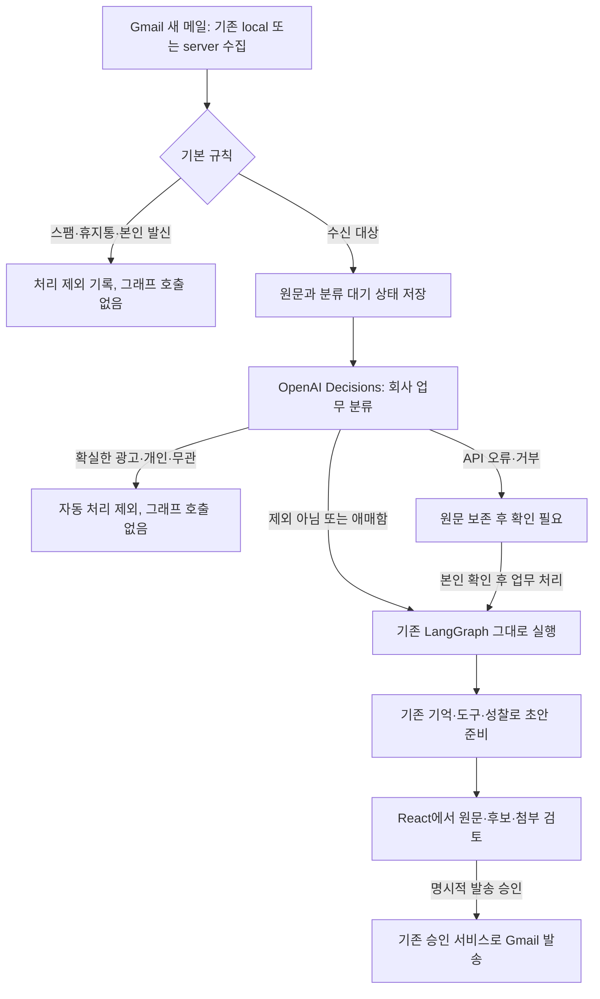

# 회사 메일함 개발 계획

- 작성: 2026-11-16. **1~5절 로컬 구현·검증을 완료했다. 2026-11-18 요청자가 push·PR·검사 통과 후 병합을 승인했다.**
- 목표: 기존 Gmail 수집 방식을 유지하면서 로그아웃 뒤에도 수집하고, 광고·개인·업무 무관 메일만 앞에서 제외하고 나머지는 기존 LangGraph에 전달한다. React에서 원문·초안·관련 문서를 검토한 뒤 본인 승인으로 발송한다. 국내 견적은 기존 단가 계산과 PDF 확인을 같은 화면에 연결한다.
- 사용자 결정: ‘서비스 관련’은 견적·무역에 한정하지 않고 **회사 업무 메일 전반**으로 확대한다. OpenAI 호출은 허용하며 Gmail 쪽 무료 사용 범위를 유지하는 방향이다.
- 관련 요구사항: R-01·R-02·R-04·R-05·R-06·R-09·R-10·R-11·R-12.
- 관련 Issue: 새 Issue 미발행. 기존 React 전환 계획의 메일 API/화면 18·19절과 범위를 대조해 중복 구현하지 않는다. 실제 Google 설정·운영 확인은 기존 #193·#157과 연계한다(현재 완료 여부 미확인).
- 공통 그래프 상태·분기·노드는 변경하지 않는다. 기존 분석 프롬프트만 회사 업무 범위로 갱신한다. 수신 전 제외·메일 API·화면은 기존 서비스에 연결하며 새 공통 그래프 조율은 필요하지 않다.

### 변경 전과 구현 방향

| 영역 | 현재 | 목표 |
|---|---|---|
| 실행 | React 3000, FastAPI 8000 | 그대로 유지. 추가 `/auth` 프록시 없음 |
| 수집 | local은 계정별 history 조회 후 30초 대기, server는 watch/Pub/Sub | 같은 진입점·토큰·커서·사용자별 중복 방지 재사용 |
| 로그아웃 | React와 legacy 로그아웃에서 watch/로컬 수집 중지 | 앱 세션만 종료. 연결 해제·권한 취소·프로세스 종료가 수집 중지 조건 |
| 분류 | 일부 라벨/no-reply를 제외한 뒤 `start_run()` 호출, 그래프 안에서 Responses로 general/deal/ignore 분류 | 먼저 Decisions로 확실한 광고·개인·업무 무관만 제외하고 나머지는 기존 그래프 시작 |
| 메일함 | `/inbox`·`/threads/...`는 HTML, React `/app/inbox`는 안내 화면 | 기존 서비스를 JSON API와 React 화면에서 사용 |
| 발송 | 승인 서비스가 후보 claim·사용자 확인·발송 1회를 담당 | 같은 서비스 사용. 문서 승인과 메일 발송은 별개로 유지 |

‘계속 수집’은 브라우저 로그인 여부와 독립이라는 뜻이다. 로컬 PC/앱이 꺼지거나 서버가 정지·절전된 동안의 상시 실행까지 보장하지 않는다. 현재 서버 BackgroundTasks의 재시작 한계는 아래 DB 대기 상태 복구로 좁히되, 별도 큐 서비스나 유료 상시 서버는 추가하지 않는다.

### 목표 흐름

### Decisions 사용 판단과 최소 데이터 계약

OpenAI 공식 [Decisions 안내](https://developers.openai.com/api/docs/guides/decisions)를 확인했다. 고정 선택지 분류에 적합하며 현재 지원 모델은 `gpt-6-luna`다. 설치된 `openai==3.49.0`에도 `client.decisions`가 있어 패키지 추가가 필요 없다. 출력의 선택·confidence를 검증하고, 임계값은 합성 업무 메일 평가로 정한다. confidence를 정확도 보장으로 취급하지 않는다. 실제 API 권한은 합성 입력으로 확인했다. 작은 표본의 품질과 실제 Gmail 확인은 5절/시험 기록에서 구분한다.

- 새로운 분류 에이전트·그래프를 만들지 않는다. 작은 `classify_email()` 함수와 기존 SDK로 충분하다.
- 사전 분류 선택지는 `exclude/keep` 두 가지다. `exclude`로 판단하고 confidence가 보수적인 초기 기준 0.95 이상일 때만 제외한다. 낮은 confidence와 애매한 메일은 기존 그래프로 넘긴다. 초기 기준의 실제 정확도는 5절에서 확인하며 확률을 정확도 보장으로 취급하지 않는다. 회사 업무에는 고객/거래처 문의, 사내 협업, 채용, 계약, 회계·청구서, 구매, 배송, 업무 시스템 알림을 포함한다.
- `no-reply`, 프로모션·소셜 라벨은 업무 제외의 확정 근거로 쓰지 않는다. 자동 발행 청구서·전자계약·업무 시스템 알림이 누락되지 않게 한다. Gmail SPAM/TRASH는 자동 처리에서 제외하며 스팸 폴더 전체 가져오기는 범위 밖이다.
- 처리 대상 여부만 앞에서 판단한다. 일반 문의/거래/답장 불필요는 기존 그래프의 `analyze_email`과 general/deal/ignore 분기를 사용한다. 그래프 상태·분기·노드를 추가하지 않고 역할 프롬프트만 회사 업무 전반으로 넓힌다. `ignore` 결과도 메일함에서 원문을 조회할 수 있다.
- 제목·보낸 사람·수신자·정규화한 본문과 본인 회사명만 전달한다. 과거 스레드 맥락은 1차 분류에서 읽지 않는다. 긴 본문을 임의로 잘라 확정 제외하지 않고, 판단에 필요한 입력이 부족하면 확인 대상으로 남긴다. 첨부 내용을 무조건 AI에 보내지 않는다. 메일 속 명령은 분류/시스템 지시로 실행하지 않는다.
- `ProcessedMessage`에 `triage` JSON(선택, confidence, 모델, 정책 버전, 처리 시각, 사용자 확인 여부)을 저장하는 안을 사용한다. 자유 서술 설명을 받기 위해 별도 생성 API를 추가하지 않는다. 화면 사유는 분류 코드와 정책으로 표시한다.
- triage 의미와 처리 상태는 구분한다. 새 상태는 `needs_review`만 추가하고 분류 진행은 triage.phase에 저장하며 기존 `processing/awaiting_approval/sent/error/ignored`를 재사용한다. 상태만으로 광고인지 업무 알림인지 추정하지 않는다.
- Decisions 결과가 없는 기존 DB 행은 미분류로 취급하며 일괄 재분류·과거 메일 자동 AI 호출은 하지 않는다. 입력/응답은 Pydantic의 고정 선택지로 검증한다. Decisions 실패를 업무로 가정해 그래프를 실행하거나 Responses로 몰래 대체하지 않는다.
- `UserKeyAccess`로 local `.env`/server 본인 저장 키 정책을 재사용한다. `local_worker`는 기존 PC 프로토콜이 Decisions를 지원하지 않으므로 이 계획의 초기 제공 범위에서 제외하고, 해당 사용자에게는 분류 보류/미지원 상태를 표시한다. 서버 환경 키로 대체하지 않는다. PC 분류 지원이 필요하면 별도 작업으로 다룬다.

### API·화면 계약

라우터 → 메일 서비스 함수 → 메일 DB 접근의 세 경계로 둔다. 기존 `app/mail/`, `app/services/`, `app/db/`를 사용하며 범용 CRUD Repository·새 DI 컨테이너·서비스 프레임워크를 만들지 않는다. 분류와 발송처럼 외부 호출이 있는 함수만 기존 주입 방식/작은 Callable로 테스트 대역을 받는다.

| API | 역할 |
|---|---|
| `GET /api/mail/threads?status=...&cursor=...` | 본인 수집 메일을 스레드별로 묶어 목록·다음 커서 제공. 상태 필터는 최신 수신 메일 기준 |
| `GET /api/mail/threads/{thread_id}` | 본인 원문 텍스트·수신/발신 대화·분류·초안 후보·관련 문서·발송 결과 |
| `POST /api/mail/messages/{id}/process` | 분류 보류/오분류 메일을 본인이 확인해 업무 처리. 입력으로 모델 결과나 다른 user_id를 받지 않음 |
| `GET /api/mail/candidates/{id}/preview` | 실제 Reply-To/From 수신자·후보·관련 문서를 최종 확인 |
| `POST /api/mail/quotes/{id}/prices` | 기존 국내 견적의 누락 단가만 확정. 기존 fill_prices 계산·ready 이후 수정 금지 유지 |
| `GET /api/mail/quotes/{id}/preview.pdf` | 본인 국내 견적의 기존 PDF 확인 |
| `POST /api/mail/candidates/{id}/send` | 후보 선택에 대한 명시적 승인. 후보 종류에 맞는 기존 승인 서비스를 호출 |

발송 입력은 임의 수신자/본문/문서가 아니라 본인 후보 ID로 제한한다. 1차 범위는 기존 후보의 확인·선택·발송이며 자유 본문 편집·수동 새 메일 작성은 제외한다. 후보/문서를 변경하는 기능을 나중에 추가할 때 버전 검토 계약을 함께 추가한다. 기존 후보가 변경·종료됐으면 서버가 거부하고 재조회한다. 문서 후보는 원문 확인과 기존 문서 검토를 마쳐야 발송 가능하며 단순 답장 승인으로 문서 검토를 우회하지 않는다.

기본 화면은 PC의 목록/상세 2열, 모바일의 목록→상세다. 목록에는 보낸 사람·제목·미리보기·수신 시각·처리 상태, 상세에는 시간순 원문과 초안 후보·첨부 확인·보내기를 둔다. ‘전체/답장 대기/확인 필요/보냄/처리 제외’ 필터와 제목·발신자 검색부터 시작한다. 전체는 연결 이후 수집한 수신 메일이며 Gmail 과거 전체 동기화가 아니다. 처리 제외 메일도 조회할 수 있게 하되 SPAM/TRASH 전체를 별도로 수집하지 않는다.

원문은 React 텍스트 렌더링으로 표시한다. 임의 HTML 실행·외부 이미지 자동 로딩은 하지 않는다. 관련 첨부는 기존 소유권이 확인된 다운로드 경로만 사용하고 1차에는 새 첨부 저장 파이프라인을 만들지 않는다. 기존에 확보하지 않은 Gmail 첨부는 Gmail 원문에서 확인하도록 안내한다. 문서함 검색/RAG 연결은 이번 범위 밖이다.

## 1. 앱 로그아웃과 Gmail 수집 수명 분리 (완료)

- 할 일: `frontend/src/AuthProvider.jsx`의 로그아웃 전 Gmail 중지 호출을 제거하고 Supabase signOut만 수행한다. `app/auth/gmail.py`의 `/logout`은 기존 클라이언트 호환을 위해 인증된 상태 조회만 반환하게 하고, `app/auth/session.py`의 legacy 로그아웃/재연결 취소도 기존 연결을 중지하지 않게 한다. `/disconnect`의 토큰 폐기·수집 중지는 유지한다. 서버는 로그인·알림 유무와 독립적으로 기존 `renew_watch_if_due()`를 실행하는 작은 lifespan 주기 작업을 둔다. 활성/재시도 계정만 조회하며 중지/연결 해제·토큰 만료 계정은 자동 재활성화하지 않는다. local 수집기는 기존 주기를 유지한다. 계약 9.1절·README의 중지 조건과 테스트를 갱신한다.
- 완료 기준: React/legacy 로그아웃 후 새 메일이 수집되며, 로그아웃 사용자는 API 읽기/발송이 거부된다. 연결 해제 뒤 추가 수집이 중지되고 재연결 전까지 재개되지 않는다. Google·세션 만료를 구분하고 서버 감시 갱신이 화면 방문 없이 실행된다. watch 갱신/앱 재시작은 기존 history 커서를 보존한다. 종료 때 주기 작업이 정리된다.
- 영향받는 상태·도구·노드: GmailWatch, GoogleToken, LocalGmailCollector. 그래프·도구 변경 없음.
- 섞지 않을 것: 분류 API·메일 화면·과거 메일 동기화·수집기 교체·새 큐/크론 서비스.
- 선행 작업: 없음. 기존 로컬 콜백 수정은 보존하며 실제 Gmail API 활성화 여부는 별도로 확인한다.
- 하는 사람: Codex.

## 2. Decisions로 명확한 무관 메일만 제외 후 기존 그래프 실행 (완료)

- 할 일: 확정된 exclude/keep 계약을 `docs/CONTRACT.md`에 기록하고 Alembic으로 기존 메일 표에 triage JSON만 추가한다. 공통 `collect_history()`에서 원문/대기를 저장한 다음 작은 Decisions 함수를 호출한다. local과 server가 같은 함수를 사용한다. 확실한 제외만 종료하고 나머지는 기존 `start_run()`을 호출한다. 기존 그래프 상태/분기는 변경하지 않으며, 회사 업무 전반을 다루도록 분석 프롬프트 버전만 갱신한다. 사용자는 이 설계와 Decisions 채택을 승인했다.
- 완료 기준: 스팸/무관 메일은 그래프·기억 요약·초안 생성 호출 0회, 제외되지 않은 메일은 그래프 1회이며 답장 불필요는 기존 그래프가 결정한다. 광고·개인 메일과 회사 청구서·no-reply 계약 알림·짧은 회신·인사/채용 메일을 포함한 합성 평가를 한다. 애매함·저신뢰는 기존 그래프로 전달하고 429·통신 오류·거부·잘못된 응답은 원문 보존 후 `needs_review`다. 임계값은 업무 메일 누락을 중점으로 검증하고 고정 상수를 추가하기 전 근거를 남긴다.
- 할 일(중복/복구): 메일 unique key와 사용자별 잠금은 유지한다. Gmail 조회 실패는 커서를 보존하고, 메일이 DB에 저장된 후 AI 분류만 실패한 경우에는 수집 커서를 계속 진행시켜 다음 메일 수집을 막지 않는다. 기존 사용자별 프로세스 잠금으로 수집·수동 처리·복구를 직렬화한다. DB의 새 미완료 대기를 다시 확인하고 이미 후보가 있으면 재사용한다. 그래프 실행 중 중단은 자동 재실행 대신 확인 필요로 남긴다. 이 지원 범위는 기존과 같은 단일 앱 프로세스이며 다중 프로세스 수집이 필요하면 별도 DB 임대를 추가한다. 분류 보류는 매 주기마다 유료 API로 무한 재시도하지 않고 본인 재시도를 기다린다. 별도 작업 큐 제품은 추가하지 않는다.
- 완료 기준(중복/복구): 같은 알림 재전달, 두 탭 처리, 분류 대기 중 연결 해제, 분류 직후/그래프 직후 프로세스 재시작을 가짜 공급자와 실제 임시 DB로 시험한다. 이미 저장된 후보가 있으면 이를 재사용한다. 중간 모델 요청의 정확한 1회 과금은 보장하지 않지만 후보 중복 생성과 메일 중복 발송은 막는다. 토큰·원문을 일반 로그에 남기지 않는다.
- 영향받는 상태·도구·노드: ProcessedMessage.triage, start_run 호출 전 제외 함수, 기존 analyze_email 프롬프트. AgentState·general/deal/ignore 분기는 그대로다. 새 업무 도구/새 StateGraph 없음.
- 섞지 않을 것: React 화면·RAG·새 생성 모델·PC 실행기 프로토콜 확장·Gmail API 변경·과거 메일 자동 분석.
- 선행 작업: 1절. Decisions 사용 채택(사용자 확인 완료) 및 실제 계정 권한 확인(5절의 사전 확인 부분).
- 하는 사람: Codex.

## 3. 기존 메일 조회·승인 서비스를 Bearer API로 연결 (완료)

- 할 일: 2절의 확정 계약을 읽고 위 API를 `app/mail/`에 둔다. 기존 inbox/thread 조회에서 SQL만 작은 메일 DB 모듈로 모으고 HTTP/HTML 표시 코드는 분리한다. 후보/문서 소유권과 관계를 확인한 뒤 기존 `send_approved_candidate/quote/trade_document`로 위임한다. `quote_id`뿐 아니라 현재 HTML에서 빠진 `trade_doc_id`·종류·문서 상태도 반환한다. 기존 HTML 경로는 유지한다.
- 완료 기준: 본인 원문·초안·업무 알림·제외·분류 보류를 조회할 수 있다. 다른 사용자의 메일/후보/문서는 404, 잘못된 Bearer는 쿠키로 우회하지 않는다. 중복 클릭/동시 승인에서 발송은 1회이고 시간 초과 등 발송 여부 불명은 자동 재발송하지 않는다. 미검토/변경된 문서는 발송하지 않고 필요한 검토 화면으로 안내한다. 분류 오류가 있어도 원문 조회는 된다. 수동 처리는 본인 수신 메일에만 허용하고 기존 후보/실행이 있으면 재생성하지 않는다.
- 영향받는 상태·도구·노드: 메일 API DTO, 기존 ProcessedMessage/ThreadMessage/ReplyCandidate/Approval. 수동 처리도 2절의 동일 서비스 진입점을 사용한다.
- 섞지 않을 것: 새 발송 엔진·Gmail 범용 프록시·후보 자유 편집·문서 승인 정책 변경·legacy 전체 삭제.
- 선행 작업: 2절. API 상태/응답을 계약 9.1절에 기록해 4절이 같은 계약을 사용한다.
- 하는 사람: Codex.

## 4. React 받은메일 목록·원문·초안·발송 화면 (완료)

- 할 일: 3절 계약을 읽고 `/app/inbox` 안내 화면을 실제 목록/상세로 교체한다. 기존 AuthProvider·apiFetch·CSS 토큰을 재사용하고 `frontend/src/mail/`에 페이지와 필요한 작은 컴포넌트만 둔다. 선택 스레드는 URL에 저장해 새로고침/뒤로가기를 지원한다. 서버 페이지네이션·상태 필터와 제목/발신자 검색을 연결한다. UI는 Gmail 연결 여부와 수집 상태를 따로 표시하며 연결 오류는 기존 설정 화면에서 확인하게 한다.
- 완료 기준: 목록→원문→후보 선택→받는 사람/본문/첨부 확인→명시적 보내기까지 완주한다. 업무 알림과 무관/스팸 판정에는 자동 초안이 없고, 확인 필요 메일은 분류 확인/업무 처리 동작을 제공한다. 실제 응답을 받은 뒤에만 발송 완료를 표시하며 전송 중 중복 조작을 막는다. 문서 검토가 필요하면 기존 화면으로 연결한다. 모바일 390px에서 목록/상세를 전환하고 키보드로 선택·발송 확인이 가능하다. 로딩·빈 목록·401·연결 해제·API 오류·발송 불명 상태를 구분한다.
- 할 일(React 단순화): 기존 주기 조회 패턴을 사용하며 목록은 30초, 선택 상세는 처리 중일 때만 더 짧게 조회한다. 화면이 숨겨지면 조회를 멈추고 복귀 때 갱신한다. 타이머/요청은 cleanup·AbortController로 정리하고 계정 전환/늦은 응답을 무시한다. 로컬 상태는 선택 후보·확인창 정도만 두고 필터 결과/버튼 가능 여부는 응답에서 계산한다. 새 전역 상태 라이브러리·WebSocket·SSE는 추가하지 않는다.
- 영향받는 상태·도구·노드: React App 라우트, 받은메일 페이지, 기존 Supabase 로그인 컨텍스트. 발송은 3절 API만 호출한다.
- 섞지 않을 것: 메일 작성 에디터·새 메일 작성·Gmail 라벨 편집·전체 Gmail 복제·지식 문서 검색·UI 전체 재설계.
- 선행 작업: 3절. 1절이 제공하는 로그아웃 이후 수집 상태와 2절 분류 결과를 표시한다.
- 하는 사람: Codex.

## 5. 실제 Google 설정·분류 품질·발송 확인 (완료)

- 할 일: 사전에는 같은 Google 프로젝트의 Gmail API 활성화·콜백/동의 범위·사용자별 모델 권한을 확인하고, Decisions 채택과 회사 업무의 합성 예시/판단 기준을 최종 확인한다. 1~4절 후에는 테스트용 계정·가상 메일로 로그아웃 뒤 수집, 일반 업무/거래/회사 알림/스팸/개인 메일 분류와 사람이 고른 초안 발송을 확인한다. 기존 운영 토큰/암호화 키를 교체하지 않는다.
- 완료 기준: 로그인 없이 수집되는 증거와 로그아웃 중 조회/발송 거부, 무관 메일의 그래프 미실행, 업무 알림의 초안 미생성, 회사 업무의 후보 생성·같은 스레드 발송을 구분해 기록한다. 자동 평가와 실제 품질을 구분한다. local PC 종료·서버 절전 한계, Gmail 표준 쿼터와 저장소 무료 한도를 확인하며 무제한 무료/24시간 가동을 약속하지 않는다.
- 영향받는 상태·도구·노드: 운영 Gmail 연결/Decisions 권한·분류 기준·메일 발송. 코드 변경 없음.
- 섞지 않을 것: 실제 고객 메일/개인정보를 테스트 산출물에 저장, AI의 무승인 발송, 임의 유료 리소스 생성.
- 선행 작업: 사전 설정/채택 확인은 없음. 종단 간 확인은 1~4절 완료 후.
- 하는 사람: Codex(승인된 테스트 송수신/합성 시험)·사람(Google 동의·테스트 회신·운영 콘솔).

### 5절 확인 결과·검증 경계

현재 로컬 실행에서 실제 다른 계정의 수신 → Decisions → 기존 그래프 → 후보 생성 → 사용자의 테스트 값/선택 위임 → 기존 단가 확정/승인 서비스 → 실제 Gmail 답장·PDF 첨부를 확인했다. 같은 스레드·Reply-To/From 대상·In-Reply-To/References·SENT·첨부 금액을 검증했고, 완료된 같은 후보의 재승인은 already_sent이며 해당 스레드 실제 발송은 1건이었다. 가격이 없는 입력은 needs_price로 멈춘 뒤 사용자가 진행을 위임한 후에만 가상 테스트 단가를 확정했다.

HTTP/React의 인증·로그아웃·소유권·모바일·승인 흐름은 실제 FastAPI/React/임시 PostgreSQL과 가짜 Google/JWKS의 자동 검사로 확인하고, 실제 Gmail은 동일 서비스 함수와 실제 API·별도 Gmail 연결 도구로 검증했다. 실제 Supabase 계정의 브라우저 세션 소멸·Render/PubSub 운영 전환·실제 수출 서류의 업무 적합성까지 검증한 것으로 표시하지 않는다. 운영 확인은 기존 #157·#193/전환 계획의 별도 범위다. 실제 사례에서 FOB 조건을 국내 견적으로 선택한 기존 문서 인식 정책과 무관 메일 2건 통과는 개선 대상으로 남기며 상세는 시험 기록에 적는다.

### 구현 순서와 다음 요청문

사전 확인 → 1 → 2 → 3 → 4 → 5 순서로 진행한다. 각 구현 단계에서 관련 검사와 전체 회귀를 통과시키고 실제 API를 테스트 대역으로 대체한다. 1~5절의 현재 로컬 구현·자동/실제 API 검증을 완료했다. 운영 확인과 문서 판단 정책의 제한은 위 검증 경계에 둔다. 실제 발송 주소는 대화에서만 받고 문서·테스트에 기록하지 않는다. 최신 main과 통합한 뒤 필수 검사를 통과해야 병합한다.

검증 현황과 남은 실제 확인은 [시험 기록](../test-records/20261116_mailbox.md)을 기준으로 한다. 후속 요청은 운영 확인 또는 기록에 남긴 분류/문서 판단 개선만 대상으로 작성하며 완료된 기능을 다시 만들지 않는다.
