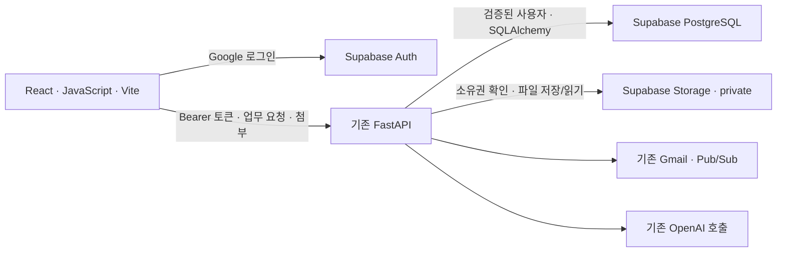

# React·JavaScript·Vite / Supabase 전환 계획

- 목표: TradeMate 시안을 React 화면으로 구현하고 로그인은 Supabase Auth, 업무 데이터는 Supabase PostgreSQL, 첨부·회사 이미지·발급 파일은 비공개 Supabase Storage에 저장한다. 기존 FastAPI·문서 계산·검토·Gmail 승인 업무를 재사용한다.
- 기준: 2026-11-12, upstream main `c8a73c2`. 이 문서는 계획이며 구현·콘솔 설정·데이터 이전·운영 전환은 아직 하지 않았다.
- 관련 Issue: #129~#150(아래 작업표). 기존 기반은 `docs/plans/trade-domain-api.md` 1~4절, Gmail 기반은 `docs/plans/gmail-quote-mvp.md`다. 기존 Issue의 남은 작업 완료 여부는 이 계획으로 판단하지 않는다.
- 관련 요구사항: R-03(누락 안내), R-04(실제 API), R-06~R-08(기억 보존), R-11(실패·재시도), R-12(실제 시험), R-14(화면·배포), D-01~D-04. UI 교체가 기존 R-01·R-02·R-09·R-10·R-13을 대체하지 않는다.
- 조율함: 미확인. DB·로그인·검토·파일 저장을 고치는 후속 작업은 공통 기반/검토 담당과, Gmail 화면은 해당 기능 담당과, 첨부 내용 추출은 이미지→견적서 담당과 범위를 조율한다. 이번 PR은 업무 코드를 고치지 않는다.
- 시안: `trade-agent ui_시안.html`(제공 파일 SHA-256 `26a423b9ecc69e6bb3cc518fec73452825578b04e4caaca7cf07b99a89c6d73a`). 시안 안의 문구·수치·동작은 참고 자료이며 신규 기능의 완료 근거가 아니다. 다른 사람이 구현할 때 같은 파일을 첨부한다.

### 확정된 선택과 계획 기본안

| 구분 | 내용 | 근거/상태 |
|---|---|---|
| 화면 기술 | React + JavaScript + Vite, `.jsx`/`.js` | 사용자 선택. TypeScript 추가 안 함 |
| 로그인/DB/파일 | Supabase Auth / PostgreSQL / Storage | 사용자 선택. 실제 프로젝트 설정 미확인 |
| 백엔드 | 기존 FastAPI·SQLAlchemy·Alembic 유지 | 현재 구현 재사용 |
| 로그인 화면 | 시안의 Google 로그인부터 연결 | 계획 기본안. 이메일 가입·다른 로그인 공급자는 별도 요구가 생길 때 추가 |
| 인증 전달 | React JSON 요청의 `Authorization: Bearer <Supabase access token>` | 계획 기본안. 기존 쿠키 로그인과 구분하며 1절에서 계약화 |
| 배포 | 기존 Render FastAPI가 React 빌드 파일도 같은 출처에서 제공 | 계획 기본안. 새 프론트 호스팅·Next.js 서버 추가 안 함 |
| 파일 전송 | 작은 파일은 React → FastAPI → 비공개 Storage | 계획 기본안. 브라우저 직접 업로드·서명 업로드 절차는 필요할 때 추가 |
| 기존 데이터 | 보존을 기본으로 복사·검증한 뒤 전환 | 삭제 승인으로 해석하지 않음. 기존 SQLite·Render 데이터의 보존 대상은 2절에서 사람이 확인 |
| SQLite | 앱 기본값·운영 경로·새 테스트 의존성을 PostgreSQL로 교체 | 기존 파일을 바로 삭제하지 않음. 과거 SQLite를 읽는 일회성 이전 경로와 역사적 migration은 구분 |
| 첨부의 범위 | 업로드·조회·다운로드·문서 출처 연결 | 저장이 곧 PDF 추출/OCR 완료를 의미하지 않음. 내용 추출 범위는 아래 보류 항목 참조 |

### 현재 코드에서 확인한 출발점

- `app/config.py`는 `DATABASE_URL`을 비우면 `app/db/local.sqlite3`를 만든다. 배포 문서는 Render PostgreSQL을 사용한다고 기록한다. 운영 DB의 실제 데이터·크기는 아직 조회하지 않았다.
- `app/db/engine.py`와 Alembic은 PostgreSQL을 이미 지원한다. 저장소 전체를 Supabase SDK 쿼리로 다시 만들 필요가 없다.
- `users.id`와 업무 소유자는 정수이며 `google_sub`가 필수다. Supabase `auth.users.id`는 별도 UUID이므로 기존 외래 키를 전부 UUID로 바꾸지 않는다.
- `/api/trade/{pi|po|ci|pl}`·설정·발급 파일 API가 있다. 현재 인증은 `gq_session` 쿠키와 CSRF다(`app/web/deps.py`, `app/trade/common/api.py`).
- Gmail 연결은 현재 앱 로그인과 한 흐름이다. Google 토큰 암호화·갱신·watch·Pub/Sub·승인 발송은 이미 있고 별도 연결 기능으로 정리해야 한다.
- `company_branding`과 검토 제안의 직인/로고, `trade_artifacts.content`는 현재 DB 바이너리다. 사용자 첨부파일 저장 API는 아직 없다.
- 지금 파일 발급은 DB 한 트랜잭션에 파일 bytes와 승인을 저장한다. Storage로 옮기면 외부 파일 업로드와 SQL을 하나의 원자적 트랜잭션이라고 설명할 수 없다.
- 최신 main의 LLM은 전부 OpenAI Responses 경로다. 이 계획에서 공급자·모델·그래프를 교체하지 않는다.
- 시안은 로그인·화면 전환·가짜 승인·가짜 첨부를 보여 주며 실제 API 호출은 없다. 작업현황 수치·최근 문서·성공 표시를 그대로 하드코딩하지 않는다.

### 목표 구조와 책임



- React는 입력·선택·표시를 담당한다. 소유자, 금액, 단가 인증, revision, 승인 가능 여부는 서버가 판단한다.
- Supabase JS SDK는 로그인에 사용한다. 업무 표와 Storage를 프론트에서 직접 수정하지 않는다.
- 서버는 검증한 Supabase UUID를 기존 정수 `user_id`에 매핑한다. 요청 본문의 `user_id`, 이메일, 파일 경로는 권한 근거로 쓰지 않는다.
- 업무 DB는 직접 SQL로 접근하고 자동 Data API 노출을 끈다. 기존·새 업무 표/시퀀스/함수의 `anon`·`authenticated` 권한과 기본 권한도 점검한다. Storage의 정책은 별도다.
- private bucket의 사용자 직접 접근은 기본 거부한다. 서버 비밀키는 Storage RLS를 우회하므로 모든 파일 작업에서 서버가 소유권과 연결 대상을 확인한다.
- 개발 때 Vite를 띄우고 `/api`·Google 연결 경로를 FastAPI로 프록시한다. 배포 때 `frontend/dist`를 FastAPI가 `/app` 아래 제공한다. `/api`, `/docs`, `/healthz`, `/gmail/push`, Google callback, 공개 약관 경로가 SPA에 먹히지 않게 한다.

### 폴더·패키지 최소안

```text
frontend/
  package.json                 # 정확한 버전·dev/build/lint 명령
  package-lock.json
  index.html
  vite.config.js
  src/
    main.jsx
    App.jsx                    # URL 라우팅·로그인 경계
    api.js                     # JSON·multipart·blob 요청, 오류 정규화
    supabase.js                # Auth 클라이언트 한 개
    styles.css                 # 시안 CSS에서 재사용
    components/                # Layout·Modal·ErrorMessage 등 실제 공통 UI
    pages/                     # Login·Dashboard·Documents·Inbox·Runs·Settings
    trade/                     # 작성 화면·공통 검토·PI/PO/CI/PL 차이
app/
  auth/                        # Supabase 검증·사용자 매핑·API 의존성
  files/                       # Storage HTTP·파일 업무·API
  trade/                       # 기존 도메인 업무·저장소 재사용
  db/                          # 기존 models·migrations 재사용
```

위 폴더는 해당 기능을 구현할 때만 만든다. 처음부터 빈 폴더/클래스/배럴 파일을 채우지 않는다. 기존 `app/web`은 전환 중 기존 경로를 지원하며 React 소스를 그 안에 넣지 않는다.

- 런타임 기본 의존성: `react`, `react-dom`, `react-router-dom`, `@supabase/supabase-js`. 개발은 `vite`, React 플러그인과 필요한 lint/검증 도구만 쓴다. 구현 시 공식 지원 조합·Node 버전을 다시 확인하고 버전을 고정한다.
- 기존 `httpx`로 Storage HTTP를 호출한다. JWT 검증은 검증된 라이브러리 하나를 고정 버전으로 추가한다. JWT 암호 알고리즘을 직접 구현하지 않는다.
- CSS는 시안을 재사용한다. 초기에 Redux/Zustand, React Query, 폼 프레임워크, UI 키트, CSS 프레임워크, 범용 스토리지 추상화, 새 작업 큐·마스터 에이전트를 추가하지 않는다.
- 페이지 로컬 상태와 필요한 인증 컨텍스트만 사용한다. 같은 입력의 파생값은 렌더 중 계산하고 따로 상태로 복사하지 않는다. 서버 금액을 JS `Number`로 다시 계산해 최종값으로 쓰지 않는다.
- 저장·승인·발송은 이벤트 처리에서 한 번 요청한다. Effect로 실행하지 않고 낙관적으로 성공 처리하지 않는다. 조회는 AbortController, Auth 구독·폴링은 cleanup을 둔다. `memo`·`useMemo`·`useCallback`은 측정한 문제가 있을 때만 추가한다.
- Vite SPA에 Server Components·Server Actions·서버용 `cache()` 규칙을 억지로 적용하지 않는다. 기본 폼·명확한 이벤트 함수로 충분하면 그대로 쓴다.
- 함수는 입력 검사/업무/IO의 책임이 드러나게 작성하되 기존 폴더를 전면 재배치하지 않는다. PI/PO/CI/PL의 서로 다른 필드를 거대한 설정 JSON·범용 Form 엔진으로 합치지 않는다.

### 인증·사용자 연결의 계약 초안

| 항목 | 계획 |
|---|---|
| API 인증 | Supabase access token의 서명·issuer·audience·exp·알고리즘·UUID subject 확인. 비대칭 signing key와 신뢰한 프로젝트 JWKS 사용 |
| 사용자 표 | 기존 `users.id` 유지, 유일한 nullable `supabase_uid` 추가. Google 미연결 사용자를 위해 `google_sub` 필수 조건 조정 |
| 기존 계정 | 같은 이메일이라는 이유로 자동 병합 안 함. Supabase 로그인과 기존 Google 계정 재인증의 일치하는 provider subject를 서버에서 확인한 후 기존 행에 연결 |
| 신규 사용자 | 검증된 UUID로 한 번만 생성. 동시에 첫 접속해도 유일 제약으로 한 사용자만 생성 |
| 쿠키 혼합 | React JSON API는 Bearer만 사용. Bearer가 잘못됐을 때 기존 쿠키로 우회하지 않음. legacy HTML 경로는 전환 기간에 기존 세션을 유지 |
| CSRF | Bearer 전용 JSON은 기존 cookie/CSRF 의존성과 구분. Google OAuth state·PKCE·일회성 상태 검사는 유지 |
| OAuth 연결 | 인증된 API에서 시작 의도를 만들고 짧게 유효한 state를 통해 기존 Google 동의 화면으로 이동. callback은 state에 결합된 내부 사용자만 갱신 |
| Gmail 계정 | 초기에는 앱 로그인과 같은 Google 계정만 연결하는 기본안. 다른 메일함 연결은 별도 요구로 분리 |
| 로그아웃 | 앱 로그아웃은 연결된 Gmail watch 중지를 명시적으로 시도하고 Supabase 로그아웃·화면 상태 초기화. 연결 해제는 Google 토큰까지 별도 폐기 |
| 만료·실패 | 401이면 로그인 복구 안내, 다른 프로젝트/변조 토큰 거부. 유효한 access token의 남은 수명 동안 로그아웃 즉시 폐기가 보장되는 것은 아님을 문서화 |

Bearer-only 경로는 쿠키를 보내지 않아도 동작해야 한다. 기존 `/api/session` 의미와 다운로드 경로 변경은 1절에서 정하고, `/api/me`를 인증 상태·프로필·Gmail 연결 상태의 JSON 진입점으로 제안한다. 앱이 추측한 이메일을 Google 연결 대상 사용자로 받지 않는다. Google identity의 근거는 Auth 서비스가 확인한 공급자 identity와 Google 재인증 결과에서 얻고, 사용자가 고칠 수 있는 `user_metadata` 값만 믿지 않는다. 기존 계정 연결은 신규 자료 작성 전에 안내하며 양쪽에 이미 자료가 있으면 자동 합병하지 않는다.

### 파일 저장 계약 초안

| 대상 | PostgreSQL에 남길 것 | Storage에 둘 것 |
|---|---|---|
| 사용자 첨부 | 파일 ID·내부 소유자·원래 파일명·실제 형식·크기·SHA-256·object key·생성 시각 | 원본 파일 bytes |
| 문서 출처 연결 | 문서/종류/확인한 revision·파일 ID·업로드/메일 출처 | 해당 원본 |
| 회사 로고·직인 | 현재 설정이 가리키는 파일 ID·해시 | 버전별 불변 PNG |
| 검토 제안 | 문서·회사·계좌·이미지 ID/해시의 불변 스냅샷 | 제안 시점 이미지 객체 |
| 발급 PDF/XLSX | 기존 파일 ID·제안 ID·형식·해시·크기·object key | 승인한 버전의 실제 출력 파일 |

- private bucket 하나 `trade-files`를 기본으로 쓴다. 경로는 서버가 `{internal_user_id}/{attachments|branding|issued}/...`로 생성한다. 원래 파일명을 경로로 쓰지 않고 `..`·임의 URL·다른 소유자 prefix를 입력받지 않는다.
- 최소 새 업무 표는 첨부/이미지 메타데이터 `file_assets`와 문서 출처 연결이다. 발급 파일은 기존 `trade_artifacts`를 확장한다. 모든 파일을 추상적인 범용 엔터티 체계로 다시 만들지 않는다.
- 초기 첨부 제한 제안은 파일당 5MiB, 문서당 5개, PDF/XLSX/TXT/PNG/JPEG다. 로고·직인은 기존 2MiB PNG 검사 유지. 1절에서 이 기본안을 확정한다. 파서별 페이지·셀·압축 해제 크기 제한은 내용 추출 작업에서 별도 정의한다.
- `POST /api/files`는 한 파일씩 multipart로 받아 서버가 인증·크기·파일 시그니처를 검사하고 업로드/메타데이터 저장까지 성공한 뒤 파일 ID를 반환한다. 확장자·클라이언트 Content-Type만 믿지 않는다. 단순 업로드에 가짜 진행률을 표시하지 않는다.
- `GET /api/files/{id}`(메타), `GET /api/files/{id}/download`, `DELETE /api/files/{id}`(다른 기록에 쓰이지 않은 파일만)를 제안한다. 바이너리는 `no-store`·안전한 파일명·다운로드 헤더로 제공하며 사용자 HTML/SVG 실행은 허용하지 않는다.
- 문서 출처 연결 API는 파일 ID 목록과 기대 revision을 받는다. 소유자·문서 종류·개수·파일 존재를 검증한다. 출처 교체 시 새 revision을 만들고 대기 검토를 무효화하며 과거 버전의 연결은 보존한다. 정확한 URL·버전 payload 위치는 1절에서 확정한다.
- 업로드 성공 후 SQL 실패는 미참조 객체를 남길 수 있다. 승인된 파일/참조 중인 이미지를 요청 실패 처리에서 무조건 지우지 않는다. 미참조·충분히 오래된 객체를 목록화하고 재확인 후 지우는 수동 관리 명령으로 시작한다. 별도 크론·큐는 만들지 않는다.
- 검토·승인 파일 경로는 덮어쓰지 않는다. 새 설정/수정본은 새 객체로 저장한다. 읽을 때 소유자·승인 상태·해시를 확인한다. DB 백업과 Storage 객체 백업은 별개로 보관한다.

### 발급 파일과 SQL 사이의 실패 처리

1. 현재 검토 제안과 불변 이미지로 파일을 만든다. 문서 버전과 제안 해시는 기존 규칙대로 검사한다.
2. `{user_id}/issued/{proposal_id}/{format}/{sha256}` 같은 결정적 key에 덮어쓰기 없이 저장한다. 이미 있으면 같은 bytes인지 확인한 경우만 재사용한다.
3. 요청한 모든 형식이 저장된 다음, SQL 트랜잭션에서 문서 revision과 pending 제안을 다시 조건부 갱신하고 파일 참조·승인 상태를 함께 확정한다.
4. 업로드/렌더/SQL 확정 전 실패는 `ready/pending`을 유지한다. SQL에 기록되지 않은 객체는 발급 파일로 노출하지 않는다.
5. 동시에 승인하거나 응답만 유실돼 재요청해도 같은 제안의 기존 파일을 돌려준다. 서로 다른 bytes가 같은 key에 있으면 실패시킨다. 파일 저장 성공을 메일 발송 성공으로 처리하지 않는다.
6. 이 경계는 현재 DB-only 원자성과 다르다. 10절에서 동시 승인·부분 업로드·commit 실패·응답 유실을 실제 PostgreSQL과 가짜 Storage로 검증한다.

### 화면별 범위

| 화면 | 구현할 실제 동작 | 기존 코드/새 작업 |
|---|---|---|
| 로그인 | Google → Supabase → `/api/me`, 만료/취소/미설정 안내 | 5·6절 |
| 문서작성 | 문서 종류 명시 선택 → 문장 추출/폼 입력 → 누락 수정 → 서버 결과 표시 | 기존 도메인 API, 12~15절 |
| CI | 본인이 승인한 PI의 ID와 revision을 직접 선택 | 기존 CI 규칙, 14절 |
| PL | 원본/계산/단위별 차이 → 합계 승인/취소 → 새 revision으로 최종 검토 | 기존 PL 규칙, 15절 |
| 검토 | 제안 전체와 버전 확인 → 승인/취소/수정 → 서버가 발급한 파일 다운로드 | 기존 review, 10·12절 |
| 문서함 | 종류/상태 필터, 초안 재개, 발급 이력/다운로드, 제한된 목록임을 표시 | 16절 |
| 작업현황 | 본인 실제 집계·확인할 문서/메일. 시안 수치 제거 | 17절 |
| 설정 | 회사·통화별 계좌·판매/매입 단가·로고/직인·거래처 | 기존 설정 API 보강, 11절 |
| 첨부 | 파일 선택·실패/재시도·문서 연결·다운로드·사용 중 삭제 거부 | 8·18절 |
| 받은 메일 | 본인 메일·후보·상태, 명시적 승인 1회 발송 | 기존 service 재사용, 7·19절 |
| 실행 기록 | 본인 목록/상세/마스킹된 내보내기 | 기존 runlog 재사용, 20절 |

견적서의 현 원화·메일 연계 동작은 유지하며 초기 React에서는 해당 기존 화면으로 이동할 수 있게 한다. 시안의 독립 USD 견적 생성·환율·세금 규칙 확장은 포함하지 않는다. 계약서는 시안에서도 향후 예시이므로 생성/서명 API를 만들지 않는다. 범용 대화 에이전트 없이 문서 종류 선택+기존 문장 추출+명시적 필드 수정으로 시작한다. 여러 턴 자유대화로 자동 수정하는 기능은 별도 요구다.

### 보류할 범위와 사람이 결정할 것

- 첨부 내용 자동 읽기: 사용자의 이번 선택은 저장소다. XLSX/PDF 텍스트/이미지 OCR을 추가하려면 지원 형식·원문 근거 표시·페이지/셀/이미지 한도·모델 전달 허용 범위를 이미지 기능 담당과 먼저 정한다. 첨부를 임의로 모델에 보내지 않는다. 저장만 된 파일에 '분석 완료'를 표시하지 않는다.
- Gmail 첨부 가져오기: 서버가 Gmail에서 다운로드해 같은 파일 저장 업무를 호출하도록 확장할 수 있다. 이 계획의 필수 범위는 업로드 파일 저장/연결이다. 메일 첨부 내용 추출은 기존 담당 작업과 합쳐 별도 Issue로 잡는다.
- 이메일 가입, 초대/팀 공동 소유, 회사별 다중 사용자 권한, 전자서명, 실시간 협업, 벡터 DB, WebSocket, Redis, 대용량 업로드는 처음부터 넣지 않는다.
- 보존/삭제 대상, 보존 기간, Google 계정 연결 정책 변경, 신규 OCR/문서 파서 비용은 미확정이다. 계획 PR의 기본안으로 구분하며 실제 삭제·유료 자원 생성 전에 사람이 확인한다.
- 11/19 제출 일정에 맞춰 우선 1~12절의 PI 한 흐름을 먼저 완성한다. 아래 절은 구체적인 PR 단위이며 작업 일수·완료 보장은 아니다. 실제 진행 속도를 보고 남은 화면 순서를 조정한다.

### 작업 순서와 Issue

모든 후속 작업은 이 계획 PR 병합 뒤 시작한다. 표의 선행 번호는 해당 구현 PR도 병합돼야 한다는 뜻이다. 같은 공통 파일을 수정하는 작업은 선행 관계대로 진행한다. 담당자는 실제 착수할 때 Assignees를 확인한다. 21절은 사용자 요청(2026-11-13)에 따라 UI 개발과 병행하는 21.1 선행 배포 작업과 21.2 후속 통합 검증으로 나눈다. #149는 두 범위가 끝날 때까지 열어 둔다.

| 절 | 작업 | 선행 | 담당 | Issue |
|---|---|---|---|---|
| 1 | 전환 계약·경계 확정 | 없음 | Codex | [#129](https://github.com/encore-ai-campus/aio-03-p2-team3/issues/129) |
| 2 | Supabase·백업·콘솔 준비 | 1 | 사람 | [#130](https://github.com/encore-ai-campus/aio-03-p2-team3/issues/130) |
| 3 | PostgreSQL 테스트 환경 | 1 | Codex | [#131](https://github.com/encore-ai-campus/aio-03-p2-team3/issues/131) |
| 4 | PostgreSQL 전용 설정·이전 도구 | 2,3 | Codex | [#132](https://github.com/encore-ai-campus/aio-03-p2-team3/issues/132) |
| 5 | Supabase 인증·사용자 매핑 | 4 | Codex | [#133](https://github.com/encore-ai-campus/aio-03-p2-team3/issues/133) |
| 6 | React 기본 화면·로그인 | 5 | Codex | [#134](https://github.com/encore-ai-campus/aio-03-p2-team3/issues/134) |
| 7 | Gmail 연결 독립화 | 5,6 | Codex | [#135](https://github.com/encore-ai-campus/aio-03-p2-team3/issues/135) |
| 8 | Storage 첨부 API | 7 | Codex | [#136](https://github.com/encore-ai-campus/aio-03-p2-team3/issues/136) |
| 9 | 회사 이미지 Storage 전환 | 8 | Codex | [#137](https://github.com/encore-ai-campus/aio-03-p2-team3/issues/137) |
| 10 | 발급 파일 Storage 전환 | 9 | Codex | [#138](https://github.com/encore-ai-campus/aio-03-p2-team3/issues/138) |
| 11 | 설정 화면 | 6,10 | Codex | [#139](https://github.com/encore-ai-campus/aio-03-p2-team3/issues/139) |
| 12 | PI 작성·검토 화면 | 11 | Codex | [#140](https://github.com/encore-ai-campus/aio-03-p2-team3/issues/140) |
| 13 | PO 작성 화면 | 12 | Codex | [#141](https://github.com/encore-ai-campus/aio-03-p2-team3/issues/141) |
| 14 | CI 원본 PI 선택 화면 | 13 | Codex | [#142](https://github.com/encore-ai-campus/aio-03-p2-team3/issues/142) |
| 15 | PL 합계 확인 화면 | 14 | Codex | [#143](https://github.com/encore-ai-campus/aio-03-p2-team3/issues/143) |
| 16 | 문서함 | 15 | Codex | [#144](https://github.com/encore-ai-campus/aio-03-p2-team3/issues/144) |
| 17 | 작업현황 집계 | 16 | Codex | [#145](https://github.com/encore-ai-campus/aio-03-p2-team3/issues/145) |
| 18 | 파일 첨부 화면 | 8,17 | Codex | [#146](https://github.com/encore-ai-campus/aio-03-p2-team3/issues/146) |
| 19 | 받은 메일·승인 화면 | 7,18 | Codex | [#147](https://github.com/encore-ai-campus/aio-03-p2-team3/issues/147) |
| 20 | 실행 기록 화면 | 19 | Codex | [#148](https://github.com/encore-ai-campus/aio-03-p2-team3/issues/148) |
| 21.1 | React 빌드·FastAPI 제공·상세 주소 복구(선행 작업) | 6,7(UI 개발과 병행) | Codex | [#149](https://github.com/encore-ai-campus/aio-03-p2-team3/issues/149) |
| 21.2 | 전체 UI 통합 브라우저 검증·전환 실행서(후속 작업) | 20,21.1 | Codex | [#149](https://github.com/encore-ai-campus/aio-03-p2-team3/issues/149) |
| 22 | 실제 데이터 이전·전환 확인 | 21.2 | 사람 | [#150](https://github.com/encore-ai-campus/aio-03-p2-team3/issues/150) |

<a id="1"></a>

## 1. 전환 계약과 API 경계 확정

- 할 일: 공통 기반/검토 담당과 위 기본안을 검토해 `docs/CONTRACT.md`의 사용자·인증·DB·파일·환경변수 절 및 16절을 목표 구조로 갱신한다. `/api/me`, Bearer 전용 API, 기존 cookie 경로의 기간/역할, 파일 소유권·문서 출처 연결과 revision, Storage 실패 처리를 확정한다. `.work/design/api-choice.md`에 사용자가 선택한 Supabase를 기록하고 `.env.example`·README에는 적용 시점과 필요한 설정 이름을 반영한다.
- 완료 기준: 아래 절이 임의의 필드/URL/오류 코드를 새로 정할 필요 없이 읽을 계약이 있다. 현재 구현과 목표 계약을 구분한다. 파일 종류·5MiB/5개 기본안·보존 대상·로그아웃/watch 정책·기존 계정 연결 증명 방법의 확정/미확정이 드러난다.
- 영향받는 상태·도구·노드: 사용자 ID 매핑과 API/파일 계약. 기존 `AgentState`·도구 스키마·그래프 노드/엣지는 변경 없음.
- 섞지 않을 것: 실제 서버 기능, Supabase 프로젝트 생성, 데이터 삭제, LLM 변경, 기존 계약 전체 재작성.
- 선행 작업: 없음. 이 계획 PR 병합 및 관련 담당 조율 뒤 시작.
- 하는 사람: Codex.
- 수정 범위: `docs/CONTRACT.md`의 해당 절, `.work/design/api-choice.md`, `.env.example`, README, 최신 흐름의 해당 절. 규칙 변경은 필요한 파일 지도만 반영한다.
- 확인: 계약 필드가 기존 `users`·`trade_proposals`·`trade_artifacts`의 이행 경로와 연결되고, cookie/CSRF를 유지하는 경로와 Bearer-only 경로가 표로 구분된다.

<a id="2"></a>

## 2. Supabase와 백업·콘솔 준비

- 할 일: 팀 소유 Supabase 프로젝트와 지역, Auth Google 공급자, 개발/배포 redirect allowlist, 비대칭 signing key, private `trade-files` bucket과 크기/형식 제한을 준비한다. 업무 Data API 노출은 끄고 Storage의 사용자 직접 정책은 기본 거부로 둔다. DB 접속 문자열·SSL·연결 한도를 확인한다. IPv4 환경이면 Session pooler를 사용한다. Google의 Supabase 로그인 callback과 앱 Gmail callback을 별도로 등록한다.
- 완료 기준: 프로젝트 URL/키 종류/bucket/redirect/DB 접속 방법의 비밀 없는 체크 기록이 있다. 새 빈 개발 DB와 실제 이전 대상이 구분된다. SQLite·Render Postgres·기존 바이너리·`TOKEN_ENCRYPTION_KEY` 보존 여부 및 백업/복원 담당이 확인된다.
- 영향받는 상태·도구·노드: 외부 Auth·DB·Storage 설정과 Google OAuth callback. 그래프 변경 없음.
- 섞지 않을 것: 실제 데이터 삭제, 운영 DB 전환, 키를 Issue/PR/Codex에 붙여넣기, 비용이 드는 플랜의 임의 구매.
- 선행 작업: 1절.
- 하는 사람: 사람.
- 설정 구분(2026-11-12 사용자 요청으로 간소화): 루트 `.env` 한 곳에 `SUPABASE_URL`, `SUPABASE_PUBLISHABLE_KEY`, `SUPABASE_SECRET_KEY`를 입력한다. URL과 공개 키만 브라우저에 제공하며 서버 비밀 키·`DATABASE_URL`·Google/암호화/OpenAI 설정은 서버에만 둔다. 버킷은 기본 `trade-files`이며 변경할 때만 `SUPABASE_STORAGE_BUCKET`을 지정한다. 실제 이름은 계약 11절을 따른다.
- 확인: 로그인 callback 왕복, 비로그인 파일 공개 URL 접근 거부, 업무 Data API 접근 거부를 가상 자료로 시험한다. 개발용 설정 확인과 운영 이관 완료를 혼동하지 않는다.

<a id="3"></a>

## 3. PostgreSQL 테스트 환경으로 전환

- 할 일: 현재 `tests/test_trade_postgres.py`의 임시 PostgreSQL 실행 경험을 사용해 테스트 DB를 준비한다. 실행 시 임시 DB 하나를 시작하고 테스트별 schema/DB로 격리하는 가장 단순한 방식을 택한다. 산재한 SQLite fixture와 `StaticPool` 전제를 교체한다. `uv run pytest`가 별도 Supabase 키 없이 PostgreSQL 회귀를 실행하도록 고정 개발 의존성과 CI를 맞춘다.
- 완료 기준: 전체 테스트와 기존 데이터 upgrade·실제 서로 다른 DB 연결의 동시 승인 테스트가 PostgreSQL에서 실행된다. 선택 모듈이 설치되지 않아 핵심 DB 검사가 skip되는 상태를 없앤다. 로컬 macOS와 CI Linux의 임시 PostgreSQL 준비법을 README에 적는다.
- 영향받는 상태·도구·노드: 테스트 DB fixture·CI·의존성. 운영 상태/그래프 의미 변경 없음.
- 섞지 않을 것: 운영 Supabase 접근, API 키 투입, 제품 데이터 삭제, 광범위한 테스트 프레임워크 교체.
- 선행 작업: 1절.
- 하는 사람: Codex.
- 수정 범위: 관련 DB 테스트/fixture, `pyproject.toml`·`uv.lock`, CI, README. 역사적 SQLite 이관 검사는 한시적으로 별도 분류한다.
- 확인: 기존 테스트의 사용자 격리·UTC·JSONB·유일 제약·조건부 갱신 의미를 보존한다. 이전 DB와 SQL 순서를 공유해 테스트 간 데이터가 새지 않는지 확인한다.
- 테스트 격리: 로컬 `.env`의 실제 LLM 키가 단위 테스트에 스며들지 않게 한다. 기본 외부 HTTP는 차단하고 가짜 응답만 명시적으로 허용한다. 현재 `test_blank_nodes_do_not_claim_success`는 키 없는 실행을 전제하므로 환경과 무관한 검증으로 보완한다.

<a id="4"></a>

## 4. 앱 PostgreSQL 전용 설정과 데이터 이전 도구 (완료)

- 할 일: `Settings.resolved_database_url`의 SQLite 자동 fallback을 없애고 누락/비PostgreSQL 설정을 명확히 거부한다. SQLAlchemy·psycopg·Alembic은 유지한다. 연결 풀 상한·SSL·직접/Session pooler 연결을 정한다. 서버 시작 migration이 Supabase의 `auth`/`storage` schema를 건드리지 않게 한다. 실제 데이터 복사/대조용 일회성 명령을 만든다.
- 완료 기준: 새 개발 DB에서 기존 표와 migration이 만들어지고, 가상 기존 DB에서 사용자·후보·기억·문서 버전·승인 관계와 시퀀스가 보존된다. 환경 누락 때 `local.sqlite3`를 생성하지 않는다. 복사 명령은 dry-run/대상 확인/반복 실행 정책·중단 지점을 제공한다.
- 영향받는 상태·도구·노드: DB 연결·migration·모든 저장소의 대상. 상태/도구/그래프 필드 이름은 유지.
- 섞지 않을 것: DB SDK 전면 교체, 운영 DB 자동 이전, 사용자 원본 파일 삭제, 과거 Alembic 리비전 삭제.
- 선행 작업: 2·3절.
- 하는 사람: Codex.
- 이전 항목: 원본별 테이블 row 수, 소유자/외래 키, timestamp/JSON/정확한 금액, PK/sequence를 비교한다. SQLite 파일과 Render DB에 같은 ID가 있는 경우 합쳐 쓰지 않고 기준 원본을 사람이 정한다. Google 암호화 토큰은 같은 암호화 키가 필요하며 키를 바꾸면 재연결한다.
- 확인: 임시 PostgreSQL에서 빈 DB·기존 DB·재실행·복사 중 실패를 시험한다. 이 단계의 바이너리 bytes는 우선 보존하고 Storage backfill은 9·10절 도구로 넘긴다.

<a id="5"></a>

## 5. Supabase 인증과 기존 사용자 매핑 (완료)

- 할 일: 1절 계약을 읽고 서버 JWT 검증과 `supabase_uid` migration, 최초 접속 사용자 생성, `/api/me`와 API 의존성을 구현한다. React용 무역/설정/파일 JSON API를 Bearer-only로 연결하고 CORS의 Authorization 허용을 맞춘다. legacy 세션 의존성을 JSON 경로에서 암묵적 fallback으로 사용하지 않는다.
- 완료 기준: Google Gmail 미연결 사용자도 문서 API를 사용할 수 있다. 정상/만료/위조/다른 issuer·audience·algorithm·subject 토큰이 구분되고, 동시 가입이 한 행으로 끝난다. 다른 사용자의 문서/파일은 404이며 요청 body의 소유자를 신뢰하지 않는다.
- 영향받는 상태·도구·노드: 사용자·API 인증 의존성. 그래프 입력 `user_id`는 계속 내부 정수이며 필드 형식 변경 없음.
- 섞지 않을 것: 이메일/이름만으로 기존 계정 자동 병합, 브라우저에 서버 키 전달, JWT 수제 구현, Graph 재작성.
- 선행 작업: 4절.
- 하는 사람: Codex.
- 구현 경계: 인증 모듈 한 곳에서 JWKS·검증·매핑을 처리한다. 키 캐시 수명과 unknown kid 갱신 실패를 처리하며 요청 토큰이 지정한 임의 JWKS URL은 호출하지 않는다. 인증 실패와 인증 서버 일시 장애를 구분하고 비밀값은 로그에 남기지 않는다.
- 확인: 가짜 JWKS와 실제 서명한 테스트 토큰·PostgreSQL로 검증한다. 요청 취소/동시 사용자 생성/이미 다른 계정에 연결된 UUID도 시험한다. 실제 프로젝트 확인은 22절에서 한다.

<a id="6"></a>

## 6. React 기본 화면과 Supabase 로그인 (완료)

- 할 일: 루트 `frontend/`에 JavaScript Vite 앱을 만들고 시안의 색·레이아웃·사이드바·모바일 탐색·로그인 화면을 옮긴다. React Router로 `/app` 아래 경로를 정한다. Supabase Auth 클라이언트 한 개, 인증 경계, `/api/me` 호출, 공통 fetch/오류 처리와 개발 프록시를 만든다.
- 완료 기준: Google 로그인 시작·callback·새로고침 복구·만료·로그아웃·취소·설정 누락을 화면에서 구분한다. 비로그인 사용자가 업무 API를 호출해도 서버가 거부한다. 이전 앱의 쿠키 없이도 React 로그인이 동작한다. 빌드·lint 명령과 lockfile이 있다.
- 영향받는 상태·도구·노드: 브라우저 Auth 상태·라우팅·인증 요청. 서버 그래프 변경 없음.
- 섞지 않을 것: TypeScript, 빈 feature 디렉터리 대량 생성, 전체 UI 키트/상태 라이브러리, 아직 연결 안 된 화면의 가짜 성공 처리.
- 선행 작업: 5절.
- 하는 사람: Codex.
- 수정 범위: `frontend/`, 필요한 정적 파일 ignore/CI·개발 문서·파일 지도. 개인 `.env`는 제외한다.
- 확인: 키보드 탐색·focus·label·로딩/오류·좁은 화면을 확인한다. Auth subscription·조회 취소 cleanup을 둔다. XSS를 피하도록 사용자/메일 문자열을 기본 React 텍스트로 표시한다.

<a id="7"></a>

## 7. Gmail 연결을 앱 로그인에서 분리 (완료)

- 할 일: 1절 계약을 읽고 인증된 사용자의 Gmail 연결 시작/상태/해제 API를 만든다. Google callback은 state·PKCE·원래 내부 사용자·Google subject를 확인하고 기존 암호화 저장·토큰 갱신·watch 등록을 재사용한다. 기존 계정에 이미 자료가 있으면 재인증 근거로 기존 정수 ID를 보존해 Supabase 계정을 연결한다.
- 완료 기준: Supabase 로그인만으로 문서를 쓸 수 있고, Gmail 기능은 연결 후 켜진다. 연결 취소·권한 누락·다른 계정 연결·state 재사용/만료·계정 충돌을 거부한다. 로그아웃 때 watch 중지, 새 로그인 뒤 명시적 재개/연결 상태 확인을 기존 정책과 맞춘다.
- 영향받는 상태·도구·노드: 사용자 연결·GoogleToken·GmailWatch·OAuth 경로. Gmail 서비스·승인 서비스 재사용, 그래프 변경 없음.
- 섞지 않을 것: Gmail 자동 발송, 받은 메일 전체 재처리, 사용자가 소유하지 않은 기존 계정 병합, Supabase 토큰을 Google access token으로 사용.
- 선행 작업: 5·6절.
- 하는 사람: Codex.
- 확인: 가짜 Google로 연결→watch→토큰 갱신→로그아웃 중지→다시 연결을 확인한다. Supabase 사용자 A 상태로 사용자 B Google callback을 완성해도 B 자료를 얻을 수 없어야 한다. 감시 갱신이 legacy HTML 방문에만 의존하지 않게 API/알림 경로도 확인한다.

<a id="8"></a>

## 8. 비공개 Storage 첨부 API (완료)

- 할 일: 1절 파일 계약에 맞춰 `app/files/`의 Storage HTTP 호출과 첨부 메타데이터·소유자 API를 구현한다. 기존 `httpx`를 쓰고 timeout/오류 변환만 둔다. 업로드 크기/형식 검증, 새 object key, 메타데이터 조회/다운로드, 미사용 첨부 삭제, 문서 버전 출처 연결을 구현한다.
- 완료 기준: 파일 bytes는 Storage, 메타데이터만 DB에 남는다. 정상 업로드/다운로드 해시가 같고 다른 사용자 파일·경로 조작·빈 파일·용량 초과·위장 형식·허용하지 않는 파일은 거부한다. 문서/파일 소유자를 모두 확인하며 출처 변경 뒤 검토 revision을 다시 확인한다.
- 영향받는 상태·도구·노드: 파일·문서 출처 메타데이터와 버전. 외부 첨부를 그래프/LLM에 자동 투입하지 않는다.
- 섞지 않을 것: OCR/문서 파서, 브라우저 직접 Storage 쓰기, S3 호환 다중 공급자, resumable 업로드, 새 worker.
- 선행 작업: 7절. 공통 `app/main.py`·DB 모델·인증 경로 변경을 직렬화한다.
- 하는 사람: Codex.
- 확인: 가짜 Storage HTTP와 PostgreSQL로 업로드 성공+SQL 실패, 삭제 실패, 재요청, 연결 중 삭제 거부를 시험한다. 미참조 객체 목록/안전한 수동 정리 명령을 제공한다. 기존 발급 파일 다운로드 API는 이 단계에서 바꾸지 않는다.

<a id="9"></a>

## 9. 회사 로고·직인을 Storage로 전환 (완료)

- 할 일: 기존 2MiB PNG 검증·해시 확인을 유지하고 현재 회사 설정은 이미지 파일 ID를 가리키게 한다. 새 제안은 그 이미지 ID/해시를 고정하고 렌더 시 해당 bytes를 읽는다. 기존 `CompanyBranding`·`TradeProposal`의 바이너리를 해시 대조하며 backfill하는 명령을 만든다. 기존 Gmail 렌더 경로의 이미지 조회도 연결한다.
- 완료 기준: 설정 이미지 교체 후에도 과거 제안은 같은 이미지를 사용한다. 이미지 없음/손상/Storage 읽기 실패를 성공으로 처리하지 않는다. backfill은 같은 bytes의 해시를 유지하고 반복 실행이 안전하다.
- 영향받는 상태·도구·노드: 회사 이미지·검토 제안 스냅샷·기존 렌더 입력. `resolve_company_seal` 등 반환 의미는 유지. 그래프 필드 변경 없음.
- 섞지 않을 것: 이미지 편집 도구·다른 이미지 형식 추가·사용 중인 과거 직인 삭제·검토 우회.
- 선행 작업: 8절.
- 하는 사람: Codex.
- 확인: 가짜 이미지·가짜 Storage로 기존 PDF/직인 회귀와 설정 교체·제안 후 삭제 시도·이전 중 실패를 시험한다. 실제 바이너리 열 제거는 backfill 검증 후 22절에서 수행할 후속 migration으로 분리한다.

<a id="10"></a>

## 10. 발급 PDF·XLSX를 Storage로 전환 (완료)

- 할 일: `trade_artifacts`에 object key/크기를 저장하고 기존 bytes 다운로드를 Storage 읽기로 연결한다. 위 업로드→SQL 확정 순서, 불변 key, 중복 승인 재사용을 구현한다. 기존 발급 파일 ID/해시/승인 관계를 유지하는 backfill과 검증 명령을 만든다.
- 완료 기준: 모든 출력 형식 저장이 성공하기 전에는 승인/발급 완료가 되지 않는다. 동시 승인·응답 유실 재시도에도 한 제안/형식당 한 파일 참조만 생긴다. 승인된 같은 파일 ID로 같은 bytes를 다시 내려받는다. 다른 사용자/미승인 파일은 거부한다.
- 영향받는 상태·도구·노드: 검토 승인 저장 경계·trade_artifacts·다운로드. 문서 `ready/issued` 의미와 메일 발송 분리는 유지.
- 섞지 않을 것: 'DB와 Storage가 한 트랜잭션'이라는 가정, 업로드 실패 후 승인 유지, 문서 발급과 메일 발송 합치기, PDF 렌더러 재작성.
- 선행 작업: 9절.
- 하는 사람: Codex.
- 확인: 기존 실제 임시 PostgreSQL 동시 승인 검사를 확장한다. PDF만 성공/XLSX 실패, 업로드 후 revision 변경, DB commit 실패, 존재하는 key의 해시 불일치, 다운로드 장애를 시험한다. 가상 옛 발급 파일의 backfill 후 byte hash도 비교한다.

<a id="11"></a>

## 11. 회사·단가·계좌·이미지 설정 화면 (완료)

- 할 일: 1절 계약과 실제 `/api/trade/settings`를 읽고 React 설정 탭을 연결한다. 회사·통화별 계좌·판매/매입 단가·로고·직인을 구현한다. 시안의 거래처 관리에 필요한 최소 조회/저장 API만 기존 저장소 위에 추가한다.
- 완료 기준: 본인 설정 저장→다시 읽기→새 문서 생성에 반영되며, 통화·판매/매입 역할·거래처 범위가 섞이지 않는다. PNG 오류·누락·중복·저장 실패를 해당 입력 가까이 표시한다. 발급/기존 제안은 변하지 않는다.
- 영향받는 상태·도구·노드: 사용자별 회사·단가·계좌·이미지·거래처. 장기 기억의 기존 조회 의미는 유지.
- 섞지 않을 것: ERP/상품 재고 기능·CSV 대량 import·회사 공동 권한·화면에서 단가 검증 결과 생성.
- 선행 작업: 6·10절.
- 하는 사람: Codex.
- 확인: 브라우저로 설정 저장/재조회·통화 계좌 변경·직인 업로드·실패 후 입력 보존을 확인한다. 다른 사용자 설정 API에 접근할 수 없는 서버 검사를 유지한다.

<a id="12"></a>

## 12. PI 작성부터 검토·다운로드까지 연결 (완료)

- 할 일: 문서작성 화면에서 PI 선택→직접 폼/문장 추출→서버 초안→누락 입력→revision 수정→최종 제안→승인/취소/수정→PDF/XLSX 다운로드를 연결한다. 공통 제안 표시/선택 UI는 여기서 실제 필요만 추출해 뒤 문서가 재사용하게 한다.
- 완료 기준: `needs_input/ready/issued`가 서버 상태대로 보인다. 제안의 문서·회사·계좌·직인·revision·해시를 확인하고 선택한다. 409는 최신본 재조회와 재검토를 안내한다. 새로고침/재로그인 후 문서 ID로 재개할 수 있다.
- 영향받는 상태·도구·노드: PI 입력·서버 revision·제안 선택. 기존 가격/샘플 규칙·LLM 경로 재사용, 그래프 변경 없음.
- 섞지 않을 것: 범용 채팅 에이전트·브라우저 금액 확정·낙관적 승인·자동 메일 발송·TypeScript.
- 선행 작업: 11절.
- 하는 사람: Codex.
- 확인: 필수값 누락, 0원 샘플, 변경된 통화/상품 가격 재확인, 오래된 탭, 승인 더블 클릭, 다운로드 실패를 확인한다. 서버 렌더 PDF가 확인한 버전과 같아야 하며, 별도 미리보기 endpoint가 필요하면 소유자/버전 범위의 읽기 기능만 더한다.

<a id="13"></a>

## 13. PO 작성 화면 연결

- 할 일: 12절 UI와 기존 PO API를 사용해 공급처·구매자 역할·매입 단가·입력/추출·수정·검토·파일 발급을 연결한다. PI와 실제 같은 제안 UI만 공유한다.
- 완료 기준: PO에서 회사가 buyer이고 seller가 공급처이며 판매 단가/PI 은행 정보가 섞이지 않는다. 정상·누락·가격 미확정·revision 충돌이 서버 응답대로 보인다.
- 영향받는 상태·도구·노드: PO 화면 입력/상태. 기존 PO 업무 유지.
- 섞지 않을 것: 구매/재고 ERP·PI 필드를 억지로 재활용하는 범용 폼.
- 선행 작업: 12절.
- 하는 사람: Codex.
- 확인: 같은 상품의 매입/판매 단가가 다른 가상 자료로 입력→승인→다운로드를 시험한다.

<a id="14"></a>

## 14. CI의 승인된 PI 선택과 버전 고정

- 할 일: 본인이 승인한 PI와 정확한 revision을 선택하는 UI를 만든다. 기존 `/ci`와 `/ci/extract`에 선택한 source ID/revision을 보내고 거래 사실은 읽기 전용으로 보여 주며 선적 필드만 편집한다.
- 완료 기준: 미승인/타인 PI 거부, 원본 PI 수정 뒤에도 선택한 옛 승인 버전의 가격/수량/FOC 보존, 원본 변경 시 새 CI 생성 안내가 동작한다. 계좌·결제 정보가 출력되지 않는다.
- 영향받는 상태·도구·노드: CI 원본 PI 선택. 서버의 source ID/revision 규칙 유지.
- 섞지 않을 것: AI의 원본 PI 자동 선택, 현재 단가표 재적용, 임의 PI PDF를 승인된 DB 버전으로 취급.
- 선행 작업: 13절.
- 하는 사람: Codex.
- 확인: PI revision 1 승인→revision 2 수정→CI에서 1 선택→발급 시 거래가격이 1과 같음을 확인한다.

<a id="15"></a>

## 15. PL 포장 합계 확인과 최종 검토

- 할 일: 기존 packing-review API로 포장 행·원본 합계·계산 합계·차이·단위별 수량을 표시하고 합계 승인/취소를 연결한다. 합계 승인 뒤 받은 새 revision으로 최종 제안을 만든다.
- 완료 기준: 미승인 합계·잘못된 행은 최종 검토가 막힌다. 합계 승인과 파일 발급 승인이 별도 단계이며, 수정하면 합계와 최종 제안을 다시 확인한다. 원본 합계는 보존된다.
- 영향받는 상태·도구·노드: PL 합계 선택·revision·최종 제안. 기존 계산 유지.
- 섞지 않을 것: 브라우저 총합으로 서버 덮어쓰기, PCS/KG 합치기, 컨테이너 수×FT 계산.
- 선행 작업: 14절.
- 하는 사람: Codex.
- 확인: 원본/계산 불일치·서로 다른 단위·합계 취소·승인 후 행 수정·오래된 제안 선택을 확인한다.

<a id="16"></a>

## 16. 문서함과 재개 경로

- 할 일: 네 문서의 저장 목록을 문서함에 연결하고 종류/상태 필터·초안 재개·버전/발급 파일 접근을 제공한다. 기존 최근 50건 API의 한계를 드러내며, 전체 검색/집계가 필요하면 서버에서 최소 cursor 페이지 조회를 추가한다.
- 완료 기준: 새로고침·재로그인 후 내 문서를 다시 열 수 있고, 목록 일부를 전체 문서 수로 표시하지 않는다. 발급 문서 수정은 새 버전임을 안내한다. 타인 문서는 없다.
- 영향받는 상태·도구·노드: 목록 조회·선택한 문서 URL. 업무 계산/그래프 변경 없음.
- 섞지 않을 것: 검색 엔진·실시간 공동 편집·미사용 대량 작업 기능.
- 선행 작업: 15절.
- 하는 사람: Codex.
- 확인: 빈 목록·50건 초과·상태 필터·버전 재개·삭제되거나 접근 불가한 ID의 오류를 확인한다.

<a id="17"></a>

## 17. 작업현황을 실제 집계로 연결

- 할 일: 승인 대기·입력 필요·진행 문서·이번 달 발급·최근 업무를 본인 범위의 SQL 집계 API로 제공하고 시안 카드에 연결한다. '이번 달'과 시각 표시는 Asia/Seoul 기준을 계약에 명시한다.
- 완료 기준: 승인/수정 후 새로 읽으면 수치와 링크가 실제 상태를 반영한다. 최근 50건을 합쳐 전체 통계로 쓰지 않는다. 비교 기간 데이터가 없으면 시안의 '지난달보다 3건' 같은 문구를 만들지 않는다.
- 영향받는 상태·도구·노드: 읽기 집계. 승인·그래프 상태를 새로 만들지 않는다.
- 섞지 않을 것: 별도 통계 DB·캐시·주기적 집계 worker.
- 선행 작업: 16절.
- 하는 사람: Codex.
- 확인: 월 경계 UTC 자료·같은 문서의 여러 발급 버전·타인 자료가 포함되지 않는지 확인한다. 집계 단위는 '문서 수/발급 버전 수/파일 수' 중 1절 계약대로 고정한다.

<a id="18"></a>

## 18. 파일 첨부와 문서 출처 화면

- 할 일: 8절 API로 파일 선택·한도 안내·업로드 중/실패·명시적 재시도·문서 연결/해제·다운로드를 연결한다. 문서 종류/ID/revision과 첨부 원본/해시를 표시하고, 파일 선택만 된 상태와 서버에 저장된 상태를 구분한다.
- 완료 기준: 새로고침 후 저장된 첨부가 보이고 다른 문서로 이동해도 출처가 섞이지 않는다. 미업로드 파일·업로드 실패 파일로 '저장 완료'를 표시하지 않는다. 사용 중 파일 삭제는 서버가 거부하며 원인을 안내한다.
- 영향받는 상태·도구·노드: 첨부 UI·서버 문서 출처 revision. LLM 자동 호출 없음.
- 섞지 않을 것: 시안의 가짜 추출 문구·가짜 OCR 완료, 대용량 전송 시스템, 첨부 즉시 자동 발송.
- 선행 작업: 8·17절.
- 하는 사람: Codex.
- 확인: 파일명 특수문자·중복명·초과 개수/크기·부분 실패·취소·사용자 전환·미리보기 object URL 해제를 확인한다. 메일 첨부 가져오기는 보류 범위라는 점을 버튼/상태에 정확히 반영한다.

<a id="19"></a>

## 19. 받은 메일과 답장 승인 화면

- 할 일: 기존 inbox/thread 조회와 `send_approved_candidate`·견적/무역 발송 서비스를 JSON router에서 재사용한다. React 받은 메일 목록·스레드·후보 선택·명시적 승인·Gmail 연결 상태를 연결한다. 처리 중인 자료만 기존 90초 주기로 폴링하고 이동/완료 때 중단한다.
- 완료 기준: 승인 전 발송 없음, 더블 클릭/동시 후보 승인이 실제 한 번만 발송, Gmail 5xx/timeout은 보낸편지함 확인 후 재승인 안내가 유지된다. 후보 실패·입력 필요·추출 중·재연결 상태가 보인다.
- 영향받는 상태·도구·노드: 메일 JSON 경로·기존 승인 결과. 기존 그래프/발송 서비스 의미 유지.
- 섞지 않을 것: 읽기 API 안에서 발송, 자동 발송 재시도, 전체 메일함 동기화, 새 메일 처리 그래프.
- 선행 작업: 7·18절.
- 하는 사람: Codex.
- 확인: 가짜 Google·실제 DB로 기존 발송 회귀와 새 API의 소유자 격리를 확인한다. 기존 원화 견적 확인 경로를 연결하고 시안의 USD 독립 견적을 구현한 것처럼 보이지 않게 한다.

<a id="20"></a>

## 20. 실행 기록 화면과 내보내기

- 할 일: 기존 runlog 목록/상세/마스킹/내보내기 함수를 Bearer JSON 경로와 React 화면에 연결한다. 노드 전이·선택 이유·오류·재시도·소요 시간을 현재 기록에서 읽고 `.jsonl`을 제공한다.
- 완료 기준: 본인 실행만 조회·다운로드하며 이메일·본문·키 등 기존 마스킹이 JSON과 화면 모두에 적용된다. 실제 trace가 없는 독립 문서 작업을 그래프가 실행된 것처럼 꾸미지 않는다.
- 영향받는 상태·도구·노드: 읽기/표시만 변경. 기존 실행 기록 스키마·평가 지표 의미 유지.
- 섞지 않을 것: 새 관측 플랫폼·로그 원문 노출·측정하지 않은 성능 수치.
- 선행 작업: 19절.
- 하는 사람: Codex.
- 확인: 가짜 민감정보·실패/재시도 실행·없는 run ID·타인 run ID·export 파일 내용을 확인한다.

<a id="21"></a>

## 21. 같은 출처 배포와 통합 브라우저 검증

관련 Issue: #149. 선행 작업만 완료해 전체 UI 통합이나 운영 전환 완료로 표시하지 않는다.

<a id="21.1"></a>

### 21.1. React 빌드·FastAPI 제공·상세 주소 복구 — 선행 작업 (완료)

- 할 일: Render 빌드에서 기존 `uv sync --locked`를 유지한 뒤 `frontend/`의 `npm ci --include=dev` → `npm run build`로 `frontend/dist`를 만든다. 기존 FastAPI가 이를 `/app/`에서 제공하며 `/app/trade/pi/123` 직접 진입·새로고침은 같은 `index.html`로 복구한다. Supabase URL·공개 키는 빌드 환경에서 전달하고 서버 비밀 키·DB 접속 정보는 브라우저 산출물에서 제외한다.
- 완료 기준: 빌드 실행기와 Render 선언/기존 Dashboard 적용 안내가 있다. `/app`→`/app/`·상세 주소의 GET/HEAD·JS/CSS 형식/캐시 재검증이 정상이고 누락 자산은 HTML 대신 404다. `/api`·없는 API의 JSON 404·기존 인증 실패 응답, `/auth/google/callback`의 state 검증/리디렉션, `/gmail/push`의 인증/형식 검사/204 처리를 보존한다. `/docs`·`/healthz`·`/about`·`/privacy`·`/terms`·기존 `/static`과 `/`→`/inbox`도 유지한다. 가짜 값 빌드에서 URL·공개 키만 포함되고 서버 비밀 키·`DATABASE_URL`·Google/암호화/OpenAI 값은 포함되지 않는지 검사한다. UI 빌드가 없어도 기존 서버 경로는 작동하며 UI는 명시적인 503을 반환한다.
- 영향받는 상태·도구·노드: 배포/라우팅·정적 파일·빌드. 업무 그래프 변경 없음.
- 수정 범위: `render.yaml`·빌드 실행기·서버 정적 제공 모듈/등록·검사·배포 안내/계획/최신 흐름/파일 지도. 팀원이 작업 중인 `frontend/`의 UI·라우터·CSS·Vite 설정·package/lockfile은 수정하지 않는다.
- 섞지 않을 것: 13~20절 UI 구현, 루트/기존 화면 강제 이동, 전체 UI 통합 완료 판정, 운영 설정 적용·실제 키 시험·DB/Storage 이전, 별도 프론트 서비스 구축.
- 선행 작업: 6·7절(병합됨). 13~20절 UI 개발과 병행하며 20절을 기다리지 않는다.
- 하는 사람: Codex.
- 확인: `bash scripts/render-build.sh`, `python3 .work/check.py`, PostgreSQL 기반 `uv run pytest`, frontend lint/test/`check:env`, 가짜 공개값을 넣은 실제 빌드의 상세 주소/자산 브라우저 smoke 검사. 이 완료 표시는 코드·모의 검증이며 실제 Render 적용/로그인 성공은 별도 확인한다.

<a id="21.2"></a>

### 21.2. 전체 UI 통합 브라우저 검증·전환 실행서 — 후속 작업

- 할 일: 13~20절 화면이 연결된 뒤 필요한 화면/API 체크표를 만들고 실제 키 없는 전체 통합 브라우저 검증과 최종 전환 실행서를 작성한다. 루트/기존 진입 경로의 React 이동은 이때 정하며 운영 적용은 22절에서 한다.
- 완료 기준: 아래 대표 흐름, 모바일·키보드 접근, 사용자 격리·버전 충돌·파일 실패·명시적 발송 승인, API 404·Google callback·Pub/Sub·공개 약관을 함께 확인한 기록이 있다. 배포 산출물에 서버 키·비공개 사용자 데이터가 없고 전환/되돌리기 실행서가 있다.
- 영향받는 상태·도구·노드: 화면/API 연결 검증·전환 문서. 기존 업무 그래프/승인 의미 유지.
- 섞지 않을 것: 운영 데이터 자동 삭제, 운영 Supabase 키로 Codex에서 시험, 별도 인프라 플랫폼 재구축, 22절의 실제 운영 전환.
- 선행 작업: 20절과 21.1절 병합.
- 하는 사람: Codex.
- 확인 명령: `python3 .work/check.py`, PostgreSQL 기반 `uv run pytest`, frontend lint/build, 대표 흐름 브라우저 검증. 인증·사용자 격리·승인·파일 손실 방지에 집중하고 단순 스타일별 snapshot을 대량 추가하지 않는다.
- 브라우저 사례: 로그인/로그아웃, 설정, PI 완주, PO 역할, CI 원본 버전, PL 두 승인, 첨부 실패, stale revision, 다른 사용자 404, 중복 승인, Storage 장애, 메일 발송 불명확 오류, 모바일·키보드 접근.

<a id="22"></a>

## 22. 실제 데이터 이전과 운영 전환 확인

- 할 일: 21절 실행서에 따라 쓰기를 멈추고 실제 기준 DB/파일/암호화 키를 백업한다. 4절 이전 도구와 9·10절 backfill을 실행해 Supabase DB와 Storage를 검증한다. Render 환경·빌드 설정·Google redirect를 전환하고 가상 자료로 실제 API/화면을 확인한다. 검증 보고 후 구 DB/바이너리 열/SQLite 원본 정리 시점을 사람이 결정한다.
- 완료 기준: 보존 대상 row 수·소유자·버전·승인·파일 수/해시·sequence가 일치하고, 기존 사용자 재연결과 승인 파일 다운로드가 된다. 실제 배포 주소에서 로그인→PI 발급→재접속→동일 파일 다운로드, Gmail 승인 1회 발송, Storage 비공개 접근을 확인한 기록이 있다. SQLite fallback을 쓰는 실행 경로가 없다.
- 영향받는 상태·도구·노드: 실제 DB·Storage·Auth·Google 연결·배포. 기존 업무 상태 의미 유지.
- 섞지 않을 것: 검증 전 원본 삭제·메일 재발송·무검증 테이블 덮어쓰기·새/구 DB에 동시에 쓰기.
- 선행 작업: 21.2절 및 운영 전환 시간/보존 대상 확인. 21.1절의 최소 배포 준비 완료만으로 시작하지 않는다.
- 하는 사람: 사람.
- 전환 순서: 쓰기 중단 → 백업/복원 확인 → 복사/backfill → 데이터·파일 해시 대조 → 환경/서비스 전환 → 실제 대표 시험 → 사용자 재연결 안내 → 구 쓰기 경로 종료. 바이너리 열 DROP과 원본 파일 삭제는 검증 뒤 별도 변경으로 남긴다.
- 되돌리기: 새 서비스에 쓰기가 생기기 전에는 구 서비스/DB로 되돌릴 수 있다. 새 쓰기 이후에는 구 DB로 주소만 바꾸지 말고 쓰기를 중지한 뒤 새 데이터 보존·재이전 방안을 정한다. 원본/새 DB 양쪽에 계속 쓰는 이중 쓰기는 만들지 않는다.
- 기록: 실제 API·운영 DB를 확인한 사람/시각·가상 입력·결과·미해결 문제를 개인정보 없이 `docs/test-records/`와 Issue에 남긴다. D-01/D-02/README/배포 주소를 최종 코드와 맞춘다.

### 공식 확인 자료

2026-11-12 확인. 아래는 도구의 기능/제약 근거이며 이 계획의 제품 정책 자체를 정하는 출처는 아니다.

- [React: 불필요한 Effect 줄이기](https://react.dev/learn/you-might-not-need-an-effect) — 파생 상태·사용자 이벤트와 외부 시스템 동기화 구분.
- [Vite 시작](https://vite.dev/guide/)·[백엔드 통합](https://vite.dev/guide/backend-integration) — 개발 서버와 정적 빌드, 기존 백엔드와 함께 사용.
- [Supabase React Auth](https://supabase.com/docs/guides/auth/quickstarts/react)·[JWT 검증](https://supabase.com/docs/guides/auth/jwts) — 로그인 클라이언트와 서버 토큰 검증/JWKS.
- [Google 로그인](https://supabase.com/docs/guides/auth/social-sign-in/auth-google) — Supabase 로그인 토큰과 Google 서비스 토큰의 구분.
- [PostgreSQL 연결](https://supabase.com/docs/guides/database/connecting-to-postgres) — 상시 백엔드의 direct/session 연결, transaction pooler 제약.
- [업무 Data API 제한](https://supabase.com/docs/guides/api/securing-your-api) — Data API 비활성화·명시적 권한·기본 권한·RLS 구분.
- [키 종류](https://supabase.com/docs/guides/getting-started/api-keys) — 브라우저 publishable 키와 서버 secret 키의 역할.
- [private bucket](https://supabase.com/docs/guides/storage/buckets/fundamentals)·[Storage 접근 제어](https://supabase.com/docs/guides/storage/security/access-control) — 비공개 다운로드·서버 권한 우회와 소유권 검사.
- [표준 업로드](https://supabase.com/docs/guides/storage/uploads/standard-uploads) — 작은 파일 전송과 큰 파일의 resumable 권장. 이 계획의 5MiB 제한은 단순한 초기 제품 기본안이다.
